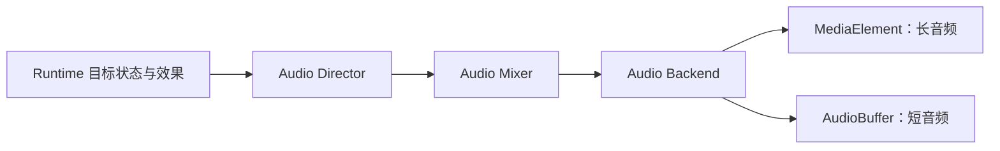

# 音频资产与 AI 配音决策

状态：已采纳，分阶段实施中

日期：2026-08-12

最近更新：2026-10-11

完整技术细节见[多轨音频与 AI 配音系统设计](/specs/2026-08-12-audio-system-design)。

## 当前落地状态

`@advjs/audio` 已实现统一 AudioEngine、六条混音总线、四个 Ambience 槽位、前景 Voice、限流 SFX、语义 UI cue、Fake Backend 与 Browser Backend。`useAdvAudio()` 是游戏、Editor 和 Studio 预览的共同宿主，旧 `useAdvBgm` 与 Howler 编排已移除。Runtime Program／Snapshot 升级到版本 2，旧音频字段通过显式映射和迁移报告升级，旧存档不兼容。

作者侧已实现 `lineId + locale + selectedTake`、不可变 take、来源和权利记录、stale 检测及 revision 检查。Qwen 与 OpenAI 复用现有 `AdvVoiceSynthesisProvider`；Node、Editor 和 Studio 使用同一创作服务与文件协议。`selectedSample` 仍只表示音色短句审核，不代替对白选择。

Editor／Studio 已提供同协议的六类素材管理、配音审核、版本化音色设计、未登记候选试听、角色与旁白 Profile、发音词典、批量任务和 Mixer；Editor 原生 Markdown 流程图与源码也可编辑场景音频，两端 JSON Flow 编辑复用原生节点、条件、连线与序列化协议。设备控制、对白预取、本地持久任务、Studio 私有离线队列、非破坏式 FFmpeg 处理、认证 TTS 服务、COS SDK 发布与标准 Flow 构建已接入。本地 HTTP 验收使用测试供应商与实际媒体工具，不代替真实模型、付费云端和 STS 部署验收。可执行流程以[音频指南](/guide/audio)和[作者语音模块](/guide/authoring-voice)为准，阶段证据见[本轮实现报告](/reports/2026-10-11-audio-runtime-implementation)，剩余验收以[实施计划](/plans/2026-08-12-audio-system-implementation)为准。

## 问题

旧 BGM 播放器以 Howler 实例和 Vue 组合式状态为中心，无法自然表达环境音分层、前景语音、SFX 并发和总线混音；这些职责不适合继续堆叠在单个 Vue composable 中。

Studio 已能调用部分 TTS Provider 并管理音频素材，但生成结果没有稳定绑定台词，也缺少多语言 take、角色音色、成本控制、权利记录和确定性发布协议。Editor、Studio、Runtime 和 COS 如果继续分别演进，将形成多套事实源。

## 决策

ADV.JS 采用统一的多轨音频与 AI 配音架构，并进行一次破坏性迁移，不保留旧音频运行时解释器。

### 一个 AudioEngine 子系统



Audio Director 管理 BGM、环境音、语音和瞬时音效的生命周期；Audio Mixer 管理 `master / music / ambience / voice / sfx / ui` 总线；Backend 隔离浏览器、原生容器和测试实现。

`useAdvBgm` 已由共享音频子系统取代，Vue 只暴露薄的 `useAdvAudio()` 订阅接口。

### 持续状态与一次性事件

| 类型   | Runtime Snapshot   | 默认并发      | 回退/读档                      |
| ------ | ------------------ | ------------- | ------------------------------ |
| BGM    | 保存目标轨道       | 1 个逻辑主轨  | 恢复目标状态                   |
| 环境音 | 保存命名槽位       | 默认最多 4 层 | 恢复各槽位                     |
| Voice  | 不作为长期舞台状态 | 1 个前景语音  | 停止旧语音，目标台词按规则播放 |
| SFX    | 不保存             | 分组限流      | 默认不重放                     |
| UI     | 不保存             | 独立短音效    | 不受剧情回退影响               |

Voice 只 duck music 和 ambience，不影响 sfx 与 ui。

### 稳定引用

- 所有运行时音频先进入 Asset Catalog，再通过 `assetId` 引用；
- 台词配音通过 `lineId + locale + selectedTake` 解析；
- ID 由 Editor/Studio 默认生成带类型前缀的 UUIDv7；
- 改名、翻译和移动文件不改变 ID；
- 重复 ID 是构建错误，不由工具静默修复。

### 角色拥有 Voice Profile

音色属于角色管理系统。角色保存 Provider 无关的音色意图，并为每个精确 locale 保存 Provider binding。台词通过稳定 `lineId` 绑定已审核 take，供应商音色与项目音色版本分别记录。

两端使用同一版本化音色设计契约，按可信宿主能力开放系统音色、描述设计与授权参考条件。候选预算审核、执行、临时试听、登记、样本选用和角色应用是独立操作；缺少授权主体、许可范围和明确同意时禁止参考生成与发布。

当前复用 Qwen MLX 的 VoiceDesign 描述条件与 Base 参考条件，以及 OpenAI 内置音色／指令。描述与参考条件用于实际合成，不冒充永久供应商音色。MiniMax 为后续供应商，按共享接口接入，不将 SDK 放入 Runtime。

### 创作账本与运行清单分离

```text
adv/audio/voice-ledger.json  → 全部 take、fingerprint、生成与权利信息
adv/assets.json             → 唯一原生目录，可分片为 assets/audio.json
AdvGameConfig.audio         → Runtime 需要的资产与各语言已选 take
```

账本进入 Git，但不包含密钥、任务锁、瞬时进度或签名 URL。构建清单不包含未采用 take、成本历史或 Provider 私有响应。

### 二进制进 COS，结构化数据进 Git

- 私有 COS 保存母版、全部 take 和未发布变体；
- 公共 COS/CDN 保存内容哈希命名的不可变发布变体；
- 临时 COS 前缀保存分片上传和媒体处理中间文件，并由生命周期规则清理；
- Git 保存项目 schema、账本、资产清单、选择关系、权利记录和可复现处理参数；
- 本地离线项目仍可使用 `provider: project` 的 Asset Catalog Profile，COS 不是 Runtime 的强制依赖。

音频对象键的规范形式：

```text
{projectPrefix}/audio/
├── voice/{locale}/{speakerId}/{lineId}/{takeId}.{hash}.{ext}
├── bgm/{assetId}.{hash}.{ext}
├── ambience/{assetId}.{hash}.{ext}
├── sfx/{assetId}.{hash}.{ext}
└── ui/{assetId}.{hash}.{ext}
```

`projectPrefix` 由 Asset Catalog Profile 提供，例如私有 `private/accounts/{accountId}/projects/{projectId}` 或公共 `games/{game-id}/v{major}`。voice 域中 locale 优先于 speaker，因为语言包发布、缺失统计和质检是主要批处理维度。普通角色的 `speakerId` 等于 `characterId`，旁白使用保留值 `narrator`；显示名只进入元数据。

### 凭证边界

- 在线 Editor/Studio：TTS 密钥只在服务端；上传使用短期 STS 或单对象预签名；
- 本地 Editor：允许环境变量或系统安全存储；
- 永久 COS 密钥只允许最小权限子账号作为本地降级方案；
- 主账号密钥禁止使用；
- 项目、日志、trace 和构建产物不保存密钥或临时签名 URL。
- `adv/audio/toolchain.json` 只能选择平台签名或服务端 allowlist 中的发布工具链；托管服务不得拉取项目任意指定的容器镜像。

### Editor 与 Studio

两端已共享资源管理、版本化音色设计、配音审核、批量任务和 Mixer：

- Editor 使用 AGUI 音频面板，原生 Markdown／JSON Flow 编辑相同的音频操作；
- Studio 提供移动端音色设计、生成队列、资产试听、六总线混音和审核发布流程；
- 两端直接修改同一 ADVScript／Flow、角色文件、Asset Catalog 和语音账本，不使用编辑器私有数据库保存项目语义。

更完整的 Runtime 音频诊断界面和真实模型／云部署验收继续按主计划建设，当前证据见实现报告。

## 后果

正向结果：

- 多轨、ducking、并发和异步竞态由一个状态机处理；
- Runtime、Editor、Studio、CLI 和测试使用同一语义；
- 配音可以可靠支持多语言、多 take、重生成和跨 Provider；
- COS 权限可以按项目/语言前缀收敛；
- 项目仍可 Git 审阅、离线运行和迁移到其他对象存储。

成本：

- 必须一次性修改共享类型、Parser、Runtime、Client、Editor、Studio、CLI、Demo 与文档；
- 旧的直接 URL、`bgmSrc` 和隐式 BGM 曲库引用会失效；
- Browser Backend 需要分别处理流式长音频和解码短音频；
- 在线 TTS 与媒体处理需要新增可信服务端任务系统；
- 生成音频带来存储、推理和 CDN 成本，需要预算与生命周期管理。

## 被拒绝的方案

### 在 `useAdvBgm` 上继续增加 Map

这会把语音、环境音和 SFX 的不同生命周期塞进单个 Vue composable，并继续暴露平行状态和回调竞态。

### 所有音频使用同一个播放器抽象

长音频需要流式加载，短音效适合预解码；用完全相同的加载策略会造成首帧延迟或内存浪费。两者共享 Backend contract，但使用不同执行路径。

### 把 Provider 参数写进 Runtime node

这会让游戏构建依赖供应商、泄露创作配置，并破坏离线确定性。Runtime 只消费最终音频资产。

### 把所有元数据放进 Asset Catalog

生成历史、未采用 take、成本和授权流程不属于运行时资产。单一巨大清单会增大构建产物并泄露创作信息。

### 按 speaker 优先组织 voice 对象键

speaker 维度便于人工浏览，但不利于按语言交付整包、统计缺失和限定本地化任务。角色与旁白查询应由索引完成。

### 将 locale 放到整个项目根之后

BGM、环境音和多数 SFX 是跨语言共享资源。全项目按 locale 分区会引入 `shared` 目录或复制公共资产。locale 只在 voice 域优先。

### 同时保留旧与新 Runtime

双解释器会长期扩大测试矩阵，并让 Editor/Studio 无法判断应该写哪种格式。本项目在 0.x 阶段选择一次性迁移。

## 不变量

- Runtime Program、Snapshot 和 effects 只包含 JSON 数据；
- 项目内容不直接引用物理音频 URL；
- 同一逻辑轨道只有当前 generation 可以提交状态；
- 构建不发起 TTS 或 COS 写请求；
- 未授权克隆音色不能生成或发布；
- 发布二进制先完成并校验，稳定 manifest 最后更新；
- Editor 与 Studio 不创建私有项目事实源；
- 无法自动迁移的旧引用必须阻断并要求人工处理。
