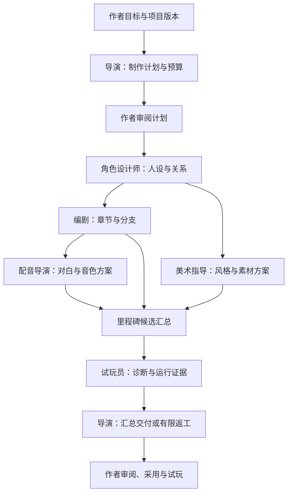

# Studio 六角色创作伙伴实施计划

- 日期：2026-10-27；最近核验：2026-10-28。
- 状态：实施中；契约、免费评测基线和本地 Runtime 链路已落地，Studio 入口及任务审阅已接入，已接入人物和章节候选修订、文字与作者宿主媒体的统一采用／恢复／撤销；已接通本机指定核心路径执行、报告保存与作者选择负责人的返工交接。真实图片与外部系统对白已在 Web 导入、试听、独立选用及正式播放器中显示／播放。导演已接通作者明确触发的交付建议及实际来源／费用／试玩记录审阅；六角色闭环、生产服务和模型对照评测尚未通过，实际进度与证据见[验收记录](../reports/2026-10-27-studio-creative-team-acceptance)。
- 范围：Studio 的导演、编剧、角色设计师、美术指导、配音导演、试玩员；共享契约兼顾 Web 与原生 iOS。
- 总 Issue：[Studio 六角色创作伙伴 #38](https://github.com/YunYouJun/advjs/issues/38)。详细任务与验收以本计划为准，Issue 跟踪阶段与阻塞；计划已随本地基础实现提交，推送后补充可访问的固定版本链接。

让作者通过一支有明确分工的创作团队，把创意变成可编辑、可试玩的 ADV.JS 项目。六位伙伴都需要实际交付；参与人数、执行顺序与模型调用次数由任务决定。

## 产品目标与首版边界

作者可以向导演描述「十分钟、雨夜车站、两位主要人物、两个结局的悬疑短篇」，审阅制作计划后，逐步获得人物设定、AdvScript 章节、视觉方案、配音方案及试玩报告，并在 Studio 中预览和采用成果。也可以直接找某位伙伴处理局部任务。

首个可用版本覆盖六种职责和完整创作闭环。美术先支持风格方案、素材需求、提示词交接和已有图片导入；配音先复用现有音色设计、音频导入与作者语音任务。只有接通且验收过的供应商可以显示「生成图片／配音」；其他情况明确提供人工导入流程。占位素材与真实生成素材分别标记。

本计划不包含模型训练、无限自主群聊、自动发布作品或首版全路径穷举。自动音乐生成继续由 [#64](https://github.com/YunYouJun/advjs/issues/64) 跟踪，不成为配音导演首版的前置条件。

## 当前实现基线

以下是制定计划时核对的源码和文档事实，实际部署仍需单独验证：

| 已有基础 | 位置与约束 |
| --- | --- |
| 五项托管能力 | `packages/agent/src/capabilities/catalog.ts`：大纲、章节草稿、情节建议、角色模拟、一致性检查；角色设计、制作计划与美术方案需要新增受控能力。 |
| 托管任务协议 | `packages/agent/src/core/contracts.ts`、`managed/v2.ts`；当前没有制作组任务图、六角色身份和协作产物契约。 |
| 单活跃任务 | `apps/studio/src/stores/useManagedAgentStore.ts` 和账户 `activeTask` 契约；前端展示多角色不等于服务端已支持并发。 |
| 提案审阅与写入 | `packages/agent/src/proposals/`；已有版本检查、编译诊断、应用及有条件撤销，应复用并补齐新内容类型。 |
| 配音作者流程 | `apps/studio/src/utils/voiceDesigner.ts`、`managedVoiceClient.ts`、`nativeProjectMutation.ts` 与[音频服务](../guide/studio/audio-service)；可连接可信作者语音宿主，不能据此认定生产托管 TTS 已开放。 |
| 试玩与项目语义 | `@advjs/core`、`apps/studio/src/utils/runtimeAuthoring.ts` 及项目预览；确定性诊断与实际运行轨迹可作为试玩报告的证据。 |
| 跨仓库执行 | [AI 服务说明](../guide/studio/ai-service)指定共享 Runtime 在 `YunLeFun/api`；新增能力和制作组持久化需要配套交付，不能只改 Studio。 |

`aiImageClient.ts` 等遗留浏览器直连代码不作为生产接入方案。模型选择、提示词、供应商凭证、定价和预算执行继续归受信 Runtime；本计划中的新契约名称均是设计目标。

## 六位伙伴的职责与交接

| 伙伴 | 主要输入 | 必须交付 | 交接与修改职责 |
| --- | --- | --- | --- |
| 导演 `director` | 作者目标、已有项目、时长与预算 | 创作简报、任务依赖、里程碑、范围调整和交付摘要 | 选择必要伙伴；将问题退回对应负责人；汇总成本和未完成项。作者保留创作决策与采用权。 |
| 编剧 `writer` | 已选定大纲、人物与世界设定、章节约束 | AdvScript 章节、对白、选择支与结局 | 承接剧情问题；修改对白后使关联配音候选过期。复用大纲、草稿和情节建议能力。 |
| 角色设计师 `character-designer` | 故事需求、世界观、既有人物 | 角色档案、关系、动机、语言风格与视觉／音色约束 | 与美术共享稳定人物 ID，与配音共享说话风格；角色模拟辅助检验人设，不替代结构化角色提案。 |
| 美术指导 `art-director` | 创作简报、人物与场景定义、已有资源 | 风格方案、立绘／表情／背景清单、参考与提示词、可采用的资源候选 | 区分叙事 Scene 和世界 Location；图像通过 Catalog 与稳定 `assetId` 引用；支持外部制作后回流。 |
| 配音导演 `voice-director` | 已冻结的对白版本、角色档案、发音词典 | 选角与音色方案、表演指示、缺失配音清单、可试听采用的 VoiceTake | 复用 VoiceDesign、对白账本和真实媒体回执；旁白独立；台词改动、音色变更和失败任务可定位重做。 |
| 试玩员 `playtester` | 原始创作目标、待验收项目版本、指定试玩场景 | 静态诊断、实际路径轨迹、带证据的问题报告及复测结果 | 独立于生成者进行检查；返回源位置、复现输入与影响；修复交给负责人产生新提案。 |

创作伙伴身份与作品内角色 ID 独立。伙伴名、头像与个性用于辨识，角色权限与可用能力由服务端验证。角色设计师和试玩员都可以调用角色模拟，但目标与产物不同。

## 协作与项目状态

采用导演统筹的有限任务图。首版顺序调度，只有服务端能力、预算和冲突处理验收后才打开受控并发。

图表示依赖关系，不承诺首版并发；用户只改一句对白时可直接进入编剧任务。导演计划需允许省略无关任务，不能为每次请求固定调用六位伙伴。

### 共享事实与候选上下文

- 已保存项目文件和作者采纳的决定是共享事实源。聊天记录、角色私有摘要和模型建议不能直接成为正式人物设定。
- 制作组可以有隔离的候选工作区；每项产物绑定来源版本、上游产物 ID 与内容指纹。候选上下文显式标注，最终写入仍走项目审阅流程。
- 每次交接包含目标、相关源文件、选定候选、约束、预期输出和剩余预算。按职责选择上下文；试玩员收到原始要求及作品，生成者的自我评价不作为通过依据。
- 上游人设、对白或资源版本改变后，将相关下游产物标为过期。独立内容可继续复用；不将所有成员历史对话重复注入模型。
- 决定日志记录作者选择、依据和被取代的版本。任务运行记录位于执行记录层，不能新增另一套不可导出的游戏剧情格式。

### 任务、预算与恢复

- 制作组运行与现有单能力任务分层：一个制作组包含若干有限任务，每个任务有伙伴、依赖、状态、输入指纹、输出、用量及错误。
- 首版保留一个活跃托管子任务；制作组队列与任务历史能够持久化。刷新、切项目、断线或 iOS 切后台后由服务端恢复，浏览器关闭不触发重复任务。
- 模型计划只可选择登记过的能力；运行器验证依赖、角色权限、输出格式、最大任务数、工具调用数、返工轮数和剩余预算。
- 默认至多两轮自动返工；达到上限、预算不足或需要创作决策时进入明确的待处理状态，不无限互相讨论。
- 总预算与子任务预占不能重复计费；若先复用单任务预占，则每次发起前原子检查制作组剩余预算和账户余额。结算未知时先对账，不能自动重试收费动作。
- 用户可以取消整个制作组或停止后续任务；已发出的不可即时中止请求显示真实状态，已完成候选保留供查看。

### 审阅、应用与资产回流

- 项目修改只由既有工作区写入入口执行；文本提案和媒体回流可分别审阅，也可组成明确的里程碑提案。
- 里程碑包含哪些源文件、媒体候选和引用必须可见；校验版本、路径、引用、媒体回执和编译结果后才写入。校验或写入失败不能显示成功，恢复与撤销范围需明确。
- 试玩在隔离的候选项目快照中运行，无须先写入正式项目；复用播放器的既有宿主隔离与插件范围，不把生成内容当作可信宿主代码执行。
- 相同文件的多个修改进入合并审阅；版本过期时重新生成／重新基线化，禁止后完成的 Agent 覆盖用户修改。
- 生成、导入、试听、采用、项目绑定和远程发布是不同状态。媒体通过现有 Catalog 与音频协议流转，发布沿用现有授权流程。

## 分阶段任务

以下 `T01`–`T12` 是总 Issue 内的任务编号，不代表已经创建了分 Issue。每项实现 PR 引用本节相应验收，不复制新的权威清单。

### M0：契约和评测基线

#### T01：定义六角色、协作产物与制作组契约

- 优先级：P0。依赖：无。
- 改动范围：`packages/agent/`；跨端消费方与 Runtime 契约对齐。
- 交付：职责与能力映射、制作组／任务／产物／交接契约、来源版本、过期与阻塞语义、兼容现有单任务的迁移方式。
- 验收：六角色身份不会与游戏角色混用；无依赖环、跨项目产物或未知能力可执行；旧五项能力客户端回归通过；新增源文件和媒体需要哪些审阅能力有明确清单。

#### T02：建立单 Agent 与多角色评测基线

- 优先级：P0。依赖：无；在正式实现与提示词优化前冻结基线。
- 改动范围：`packages/agent/test/` 或项目既有评测入口；结果放入 `docs/reports/`。
- 交付：局部修改、单章创作、完整短篇三类固定输入；比较方法、预算、评分量表和上线门槛，详见「效果评测」。
- 验收：可复跑，保存模型／提示词／工具版本、项目输入与种子；生成质量和系统故障分别统计；本轮计划不运行收费评测。

### M1：制作组基础与导演

#### T03：Runtime 登记与可恢复的任务编排

- 优先级：P0。依赖：T01；T02 的评测数据规范。
- 改动范围：`@advjs/agent`、Studio 任务 Store，以及 `YunLeFun/api` 的配套 Runtime；外部交付的链接、版本和启用状态回填总 Issue。
- 交付：新能力登记、导演计划生成与校验、顺序任务图、持久化恢复、幂等、预算、取消、有限返工与新旧协议兼容。
- 验收：重连不重复生成或扣点；跨项目／账号隔离；不支持的能力明确失败或转人工；模拟并验收额度不足、结算未知、上游修改和取消时仍有请求在途。

#### T04：制作组入口、伙伴详情和导演工作流

- 优先级：P0。依赖：T01、T03；可在契约冻结后用明确标注的 fixture 开发界面。
- 改动范围：`apps/studio/`；遵循[Studio 视觉](../about/design/studio-design)与[组件规范](../about/design/studio-components)。
- 交付：项目卡、六伙伴列表、任务详情、计划审阅、实际进度、待确认产物与预算；从项目概览和内容编辑器均可进入。导演交付建议的有限触发、冻结输入与只读审阅见[技术规格](../specs/2026-10-28-studio-creative-director-summary)。
- 验收：伙伴副标题展示真实产物或待处理项；未配置服务不会假装工作；窄屏、长中文、键盘和读屏可用；编辑、预览与任务进度可互相跳转；原有文件与内容编辑入口可继续使用。

### M2：六角色创作闭环

#### T05：编剧与角色设计师交接

- 优先级：P0。依赖：T03、T04。
- 交付：角色设计受控能力、角色档案及关系提案；编剧读取选定人设完成 AdvScript、选择支及结局；复用现有角色模拟与一致性检查。当前编剧提示词示例已改为实际对白语法和完整双结局章节，作者可在候选中按真实 AST 补齐新台词身份，保存独立修订后选定／采用；身份准备与未验收边界见[配音规格](../specs/2026-10-27-studio-creative-voice-import)。旧大纲／章节原文候选已接通固定文件编辑、不可变修订及相同请求明确重试；服务兼容位与采用边界见[采用规格](../specs/2026-10-27-studio-creative-adoption)。
- 验收：作者能预览、编辑、采用人物与章节；角色 ID 和对白引用正确；新增／修改／撤销走工作区；人设变更使受影响草稿过期；至少一份中文双结局短篇可编译试玩。

#### T06：美术指导的风格与素材闭环

- 优先级：P0。依赖：T03、T04；人物素材依赖 T05 的角色定义。
- 交付：风格与素材清单受控能力、角色／表情／场景约束、提示词交接、已有图片导入、预览采用与资源绑定。当前本机图片回流与尚未验收范围见[技术规格](../specs/2026-10-27-studio-creative-art-import)。
- 验收：人物与场景引用同一批稳定 ID；来源、尺寸与资源状态可见；图片可从外部制作回流并在游戏展示；缺失媒体明确提示；修改设定可定位需重做的素材。实际托管图片生成另由 T11 验收。

#### T07：配音导演接入现有语音作者流程

- 优先级：P0。依赖：T03、T04、T05；复用 [#18](https://github.com/YunYouJun/advjs/issues/18) 的语音基础。
- 交付：角色／旁白选角、表演指示、词典和缺失对白清单；连接既有音色候选、任务、试听采用、音频导入及章节／Flow 绑定。当前已有词典／声音意图受审写回、章节与 Flow 全部编译对白清单及真实对白本机回流；Flow 稳定 ID 已贯通同节点第二句的实际导入／试听／独立采用／Web 播放与改字过期，Markdown 完整源块也已接通多行对白及独立旁白的实际回流、播放与续行改稿过期；整部作品和其他未验收范围见[技术规格](../specs/2026-10-27-studio-creative-voice-import)。
- 验收：至少一段角色对白完成真实生成或人工录音导入 → 试听 → 采用 → 试玩播放；报告注明具体路径与宿主；按文本版本使旧音频候选过期；未知计费结果不静默重试；自动音乐生成不阻塞本项。

#### T08：试玩员提供可复现的独立检查

- 优先级：P0。依赖：T03、T05；随 T06、T07 验证媒体问题。
- 交付：编译／引用诊断、既有一致性检查、预算内的运行路径与问题回传；负责人修复后的针对性复测。当前已接入同快照的配音账本／原文件检查、问题保存与明确负责人返工；缺失、未选、过期、原文件缺失及身份不明确有独立样本。剧情疑点已有成对源引文、作者明确确认／排除、冻结报告与负责人返工交接，本地缺陷及误报样本覆盖核对流程；实际模型的检出率、误报率及修复质量仍待验收。本机执行与作者宿主报告协议见[技术规格](../specs/2026-10-27-studio-creative-playtest)，其部分实施状态不表示 T08 已全部交付。
- 验收：报告含项目版本、源位置、复现操作、预期／实际结果和轨迹；两个指定结局均实际走通；报告区分未覆盖路径、静态分析与实际播放；预埋悬空引用、不可达结局、设定冲突及缺失配音能定位，不宣称穷举所有状态。

#### T09：候选工作区、统一审阅和过期传播

- 优先级：P0。依赖：T01、T03；与 T05–T08 并行推进，集成验收依赖四项产物。
- 交付：共享事实与候选分离、版本化交接、决定记录、跨角色里程碑提案、应用与撤销。采用、中断恢复与独立作者收尾的实现设计见[技术规格](../specs/2026-10-27-studio-creative-adoption)；图片与配音的部分写入另见[媒体恢复规格](../specs/2026-10-27-studio-creative-media-recovery)。服务端作者宿主媒体登记、Studio 两个导入口、统一真实二进制事务与采用锚点已在 Web 本地协议服务中连接；同基线文字源文件已接通明确合并、不可变作者结果回执、相关下游过期与条件撤销；生产、不同基线／Flow／专用媒体记录的合并、全部入口协调和原生端仍未验收，作者收尾现已具备独立审阅／确认、费用及实际报告引用、素材待办与明确排除项的历史回执，不自动把选定或采用当作作品验收；导演现可基于实际冻结成果提供单独的交付建议；选定建议不代替作者结束决定。仍不表示 T09 已全部交付。
- 验收：作者中途改文件不会被覆盖；人设／对白修改使正确下游过期，独立资产不被误删；部分失败保留可复用成果；文本与资源绑定不会半写入；未采纳的建议不污染正式项目。

### M3：发布验收与有条件扩展

#### T10：六角色端到端验收与跨端交接

- 优先级：P0。依赖：T02、T04–T09。
- 交付：完整短篇示例、异常恢复与预算报告、正常／窄屏截图、单 Agent 对比结果、Web 发布开关和原生 iOS 接入清单。
- 验收：通过下节的六角色闭环；真实服务与本地 fixture 分开记录；未验收的云端／图片／语音能力不开放；文档只将实际验收项改为可用。
- 原生 iOS：复用相同契约与项目文件，界面遵循[原生计划](./2026-10-21-studio-native-ios)；Web 完成不勾选原生验收，相关原生集成独立跟踪实际测试证据。

#### T11：正式托管图片与语音生成适配

- 优先级：P1。依赖：T06、T07、T09，以及对应真实服务、预算与能力开放条件。
- 交付：图片及语音分别登记、定价、取消／恢复、回执核验和素材回流；只为实际可用的能力开放按钮。
- 验收：保存真实供应商与媒体回执；失败和未知结果可处理；验证角色／风格一致性、试听与游戏播放；人工导入仍可用。两种媒体分别记录完成状态，已有作者语音接入不重复实现。

#### T12：按任务选择单角色、协作与受控并发

- 优先级：P1。依赖：T02、T03、T10；并发还依赖服务端账户契约、预算与写入冲突支持。
- 交付：任务复杂度路由、可选制作组模式、并发上限、性能与成本观测；并发只处理输入已稳定且产物可独立的任务。
- 验收：短任务不固定调用六角色；同预算评测达标的任务才默认协作；并发不会突破账户／制作组限额、引发同文件覆盖或重复扣点；关闭并发可恢复顺序执行。

建议实施顺序：T01 与 T02 → T03 → T04 → T05／T06／T07／T08，并同步推进 T09 → T10；T11 与 T12 按条件启动。实现层面的并行开发不代表产品首版开启多任务并发。

## 完整短篇验收

以「雨夜车站」短篇为固定验收项目；角色与章节数量由 fixture 明确，不把时长估计当成真实试玩时长。

1. 作者从模板开始向导演提交目标，确认简报、两个结局和预算上限；计划有实际任务与负责人。
2. 角色设计师交付两位主要人物，编剧基于选定人设交付可编译章节，作者可以改写候选对白。
3. 美术指导交付统一风格与素材清单，至少一张真实导入／生成图片被采用并在预览中显示；其余缺失素材有明确状态。
4. 配音导演给出人物与旁白方案，至少一段真实对白音频完成导入或生成、试听采用和游戏播放；报告注明人工环节。
5. 试玩员实际走通两个结局，给出路径和问题证据；一次预埋问题经负责人修复后复测。
6. 导演汇总实际成果、缺失内容与费用，作者审阅并采用；关闭并重开项目后文件、资源引用与玩法一致。
7. 改变已配音台词，旧候选变为过期；制造文件冲突、断线、预算不足和取消任务，结果可恢复且不会虚报完成。

首版全自动媒体生成不是上述验收的隐含条件；六位伙伴必须各自完成真实职责，不能以静态头像或预写消息代替。

## 效果评测：多角色是否优于单 Agent

预期收益是分工覆盖、工具适配、独立检查和局部重做。收益需在 ADV 创作中验证，不能由角色数量推断。短对白润色优先验证单角色；长篇、多媒体和分支检查优先验证协作。

### 对照与输入

- A：单次生成，作为当前体验参考，不作为证明架构收益的唯一对照。
- B：强单 Agent，多步规划、调用同一批工具、自我检查与修订；享有与协作模式相同的总预算和确定性校验。
- C：导演与按需专家，共享版本化项目，试玩员独立检查；将导演、交接、审阅、重试和供应商调用全部计入预算。
- 主比较为 B 与 C。模型及版本、源项目、工具、媒体输入、总 token／费用上限和截止时间对齐；预算同时无法用尽时如实报告实际消耗与质量，不补造等量调用。
- 冻结 24 个输入：8 个局部修改、8 个单章任务、8 个短篇整合任务，每例至少 3 次独立运行。先做小样本成本试跑，再经明确预算开展完整评测；付费执行与本轮文档工作分开。
- 媒体生成先使用相同固定素材评估规划与集成；供应商采样效果另做实验，避免把更换图片或音色模型的收益归因于多 Agent。

### 指标与默认模式门槛

| 维度 | 评估方式 |
| --- | --- |
| 可用性 | 编译通过率、引用完整性、指定结局到达率、媒体绑定与播放成功率。 |
| 创作品质 | 隐去模式标记并随机顺序，由至少两位作者比较叙事、人物、风格与可玩性；LLM 评分仅辅助。 |
| 检错能力 | 预埋缺陷召回、误报与修复后复测通过率；检查者的自我宣称不计为证据。 |
| 作者负担 | 达到可接受作品所需的人工修改、确认与重复说明次数。 |
| 资源消耗 | 总费用、token、工具次数、端到端延迟及返工量；区分模型和系统失败。 |

以下是项目拟定的产品门槛，不是论文结论：同预算下，可用性和关键缺陷检出不低于 B；复杂任务的配对盲评偏好率目标至少 65%，并按输入分组报告置信区间。若区间不能排除无收益、任一关键质量回退或成本超限，则不对该任务类别默认开启协作，继续保留可选实验模式。样本不足以判断时补数据，不把小样本趋势宣传为确定提升。

质量／成本／延迟需同时展示。进一步用「关闭独立检查」和「固定调用六角色」的小规模消融确认收益来自分工与审阅，防止把更多 token、多轮修改或更强模型的收益误算成协作收益。

## 实施验证与关闭条件

- 契约与编排：测试任务图、权限、过期传播、幂等、恢复、预算和结算；从公开契约验证行为，不只镜像实现。
- 项目写入：使用独占临时项目验证新建／修改、冲突、部分失败、媒体核验与撤销；保留唯一源码与用户数据。
- UI 与端到端：按 Studio 规范检查普通／窄屏、键盘和读屏；检查编辑 → 任务 → 审阅 → 试玩 → 重开。
- 执行相关 package tests、Studio tests、类型检查及文档检查／构建；命令以实现 PR 中实际 scripts 为准。
- 实际结果写入 `docs/reports/2026-10-27-studio-creative-team-acceptance.md`，记录服务版本、环境、输入、费用、截图／轨迹、限制和关联提交；未执行的项标为未验证。
- M0–M2 及 T10 有证据后可关闭首版交付；总 Issue 中 T11／T12 若继续延期，应明确另行跟踪或维持总 Issue 开放，不能勾选为完成。
- 总 Issue 保留原 #38 的「生成剧本配置 → 生成图片 → 上传 CDN」诉求；图片与发布分别按当前产品范围及已有资源发布协议验证，不随本计划自动执行远程发布。

## 研究依据及适用限制

- [How we built our multi-agent research system](https://www.anthropic.com/research/multi-agent-research-system)：可分解、可独立探索的研究任务获得收益，也有明显 token 与协调开销；研究检索结果不能直接外推为 ADV 叙事质量提升。
- [Towards a Science of Scaling Agent Systems，v3](https://arxiv.org/abs/2512.08296v3)：控制工具、提示词与计算的对比显示，协作收益随任务结构变化，顺序依赖任务可能退化；据此采用按需分工和同预算对照。
- [Why Do Multi-Agent LLM Systems Fail?，v3](https://arxiv.org/abs/2503.13657v3)：故障涉及系统设计、Agent 间不一致和验证；据此把交接、版本和实际验收单独列为工程任务。

这些研究支持谨慎选择与评测协作结构，不构成六角色一定胜过单 Agent 的证据。
