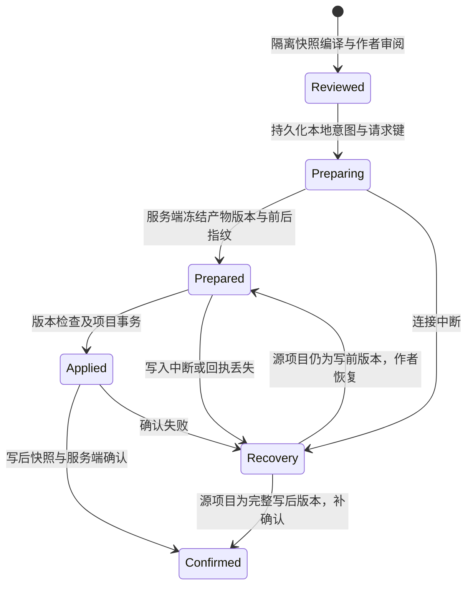

# Studio 制作组候选采用与恢复协议

- 日期：2026-10-27。
- 状态：部分实施；不可变候选修订、文字与作者宿主媒体里程碑的准备／事务写入／确认、Web 持久化恢复、条件撤销与独立作者收尾已接通本地替身联调。Studio 图片／配音导入口已连接服务端不可变登记，真实字节共用统一里程碑；同基线文字源文件合并已接通作者编辑、不可变回执和条件撤销；生产服务、Flow／媒体记录的直接合并、跨设备接续及原生 iOS 仍未验收。
- 范围：主计划 [T05／T09](../plans/2026-10-27-studio-creative-team) 的候选、正式项目写入与撤销。验收要求仍以主计划为准。

## 已实现的基础

人物和章节候选支持作者修订。每次修订创建新产物，保留 `editedFrom`、原产物、费用和决定原因；作者不能指定来源、文件路径、身份或媒体回执。修订不调用模型，不选定新候选，不修改正式项目。旧版本和相关下游变为过期，在途任务继续按实际回执结算。

Runtime 分别保存给模型的职责上下文和完整的冻结写入基线。返回产物的 `before` 来自派发时的基线，不能使用作者在生成期间刚更新的文件。源文件冲突和创建路径已被占用时，候选不得覆盖正式项目。人物叙事修订保留已有 frontmatter 中的媒体绑定与其他作者字段。

可用性声明中的 `authoring.candidateEdits` 明确表示支持修订；旧服务缺少声明时不开放按钮。新增服务的 `authoring.milestoneAdoption` 为 `true`，表示支持文字里程碑协议；未升级的服务保持关闭。查询能力、历史和已有候选不激活账户额度；新模型任务仍按既有 entitlement、预算和计费路径授权。

`authoring.voiceDirectionEdits` 另外声明配音方案的结构化修订。`voice-settings` 仅允许供应商无关的声音意图和字面词典变换；服务端从方案与写前快照重算完整变换，拒绝与声明不符的文件内容。源工作区编译这些修改后使用同一里程碑写入，不因此取得 Catalog／VoiceTake 或真实媒体核验权限。具体字段及保留边界见[配音规格](./2026-10-27-studio-creative-voice-import)。

## 旧文字候选的原文修订

`authoring.rawTextEdits` 单独声明旧 `generate-outline`／`generate-chapter-draft` 候选的原文编辑支持；同时需要 `candidateEdits`。旧服务省略此字段时保留候选查看与选定，不显示编辑入口。模型能力和输出版本没有改变。

仅允许没有结构化 `output`、媒体或建议结果，且恰有一个非删除变换的候选。大纲目标必须是 `adv/outline.md`；章节目标必须是 `adv/chapters/<文件名>.adv.md`。任务能力、产物种类与路径必须对应，不能把其他原文或媒体候选转成自由编辑入口。

作者请求使用 `{ kind: 'source-text', summary, content }`，附确切候选 ID／指纹和修改原因。文件目标、写前内容、来源及上游版本由原产物导出，禁止请求自定。摘要非空且最多 1000 字符，整个输出 JSON 的 UTF-8 编码最多 48 KiB；普通候选编辑 HTTP 请求的容量限制继续生效。空字符串表示保留空文件，不表示删除。

服务保留正文的完整字节，不修剪、重新序列化 frontmatter 或合成游戏设置；新修订仍以源文件变换保存，没有模型结构化 `output`。人物、Catalog、VoiceTake 和声音意图继续使用各自受控入口。章节可以在本地草稿中按真实 AST 补齐台词身份，必须再明确保存；源文件须经既有隔离编译和里程碑确认才进入正式项目。

Studio 编辑器保留原稿的 CRLF 换行约定，关闭或来源过期后保留本次组件中的草稿供复制；不承诺未保存草稿在刷新或跨设备后恢复。已保存修订及其 `editedFrom`、决定和上游版本随历史重开。

所有作者候选编辑使用账号、项目、运行与规范请求内容导出的稳定请求键。响应丢失后，明确重试相同请求复用原键；服务先核对已有决定并返回原修订，再检查是否需要新建。改变正文或原因生成新键，同键不同内容报冲突。异步计算期间发生账号／项目／运行切换时丢弃请求；不自动重试模型任务或正式项目写入。

## 已保存来源的核对与过期同步

服务通过 `authoring.sourceSync` 声明支持。免费鉴权 `GET /runs/:runId/source-state?projectId=...` 从同一次持久化读取返回 `{ protocolVersion: 1, run, projectRevision }`；指纹属于当前共享事实，不能使用制作计划的初始版本代替。此读取沿用账号／项目／运行边界，不派发任务、不激活额度，也不修改候选或费用。

Studio 在制作组工作区可见时核对实际文件系统；重新进入时重新采集，不假定关闭期间没有改稿。相同指纹只读取；发生变化时以现有免费 facts 接口同步保存版本，使相关候选和下游按共享规则过期。普通章节编辑器、内容保存及当前适配器的创建、写入和删除都会通知观察者，未保存表单不进入共享事实。旧服务缺少兼容位时保留原有明确核对流程，不显示已自动同步的保证。

文件系统观察保留原适配器身份、原生目录句柄及同项目写锁。先等现有排队事务（含回滚）和底层文件操作结束，再采集快照；采集或请求期间有新写入时丢弃迟到结果，并核对较新的保存版本。内存适配器只为尚未经过持久化屏障的实际变更等待 flush；初次读取与已持久化事务不额外写存储。观察通知自身的异常不能把成功写入变为失败。

核对中或失败时暂缓选定、候选修订、返工、导入、采用、试玩提交和作者收尾，保留草稿、候选及历史。停止后续任务仍可使用。存在准备中的里程碑时不上传可能的中间文件，先开放既有恢复／还原入口；完成恢复后再核对。已经由作者收尾的运行保持历史冻结，不用新项目来源改写它。

未知事实同步响应不自动重试。作者明确重试时先读取原子来源状态；服务已经保存该版本时只回读结果，不再次 POST。账号、项目、运行或文件系统改变，以及工作区卸载时，旧观察解绑，迟到结果不得更新当前范围。核对不自动选定候选、重做模型任务或修改正式项目正文。

当前覆盖共享文件系统实例内的 Studio 写入和返回工作区后的本机重新读取；另外，MemoryFsAdapter 已对同源 IndexedDB 的独立实例增加以下保护：

- 每个已保存路径具有不透明版本；旧行在修改时写入版本。持久化在同一个读写事务内核对本地编辑基线，只提交变更路径。不同路径的修改可合并，同一路径发生冲突时整批拒绝，已保存稿和失败窗口的本地草稿均保留；递归删除不能移除另一窗口新增的子文件，也不能留下孤立路径。
- 创作工作区每次获取快照前刷新持久化路径，保留本地未保存修改及其原始比较版本。旧候选在采用前发现项目修订变化时拒绝；提交前同路径再被另一实例修改时，由持久化事务再次拒绝。普通内容表单保存和删除等待持久化屏障，失败不能返回保存／删除成功。
- 二进制转换在 IndexedDB 事务外完成，文本与媒体仍在同一事务内提交；读取失败直接报告，不以空工作区继续写入。初次打开和快照刷新不写入项目。

MemoryFsAdapter 在持久化事务成功之后，通过同源、同 projectId、同浏览器存储域的 BroadcastChannel 发出失效提示。消息仅含协议版本与发送实例标识，不传正文、媒体、凭证或写权限；普通保存与隔离事务均忽略自身回声，未提交或失败批次不通知。只有存在当前来源观察订阅时才保留接收通道，作用域解绑后关闭；通知不可用或观察回调失败不改变已提交文件的结果。

收到外部提示时，观察器增加修订以丢弃迟到结果，再读取实际存储进行已有来源核对。提示不会作为事实正文或采用授权，也不会把干净的外部变化误当成本机未保存稿执行 flush；本机已有草稿仍保留其原始版本保护。窗口获得焦点、页面恢复或重新可见时补查实际保存内容，以处理广播不可用或挂起期间遗漏的通知；没有定时轮询。核对失败后，后续外部／前台提示不清除失败状态、不自动重试未知响应，仍需作者明确重试。即使前台提示已排队，稍后返回的未知结果也保持阻断；新通知不派发模型或自动采用。

对于 MemoryFsAdapter，有限采用入口还使用可选 `IFileSystem.transaction`：先持久化已有作者修改并刷新基线，再复制隔离文件视图；写前版本、写后编译和真实媒体核验都读取这份视图。暂存写入不启动自动保存，也不出现在原工作区或另一个窗口中；只有全部核验通过，才在一个 IndexedDB 事务内比较完整持久化基线并提交。此后新内存事务的进程中断只会保留完整写前或完整写后状态；历史日志和其他后端仍可能出现部分写入，原恢复协议继续保留。比较包含未被提案修改的文件、新增、删除和版本变化，防止审阅期间世界观等来源变化漏过单文件核对。

账号／项目校验在实际持久化事务中再次执行，失效会中止同一个事务。此时不执行可能覆盖其他窗口新稿的补偿回写；失败丢弃隔离视图，候选与恢复日志仍可重新审阅。隔离视图在退出时失效并释放缓存。原实例在事务期间拒绝并发普通写入，事务前后仍可编辑；观察器等待完整事务结束，且不能把通知后新开始的作者改稿误记为已持久化。其他后端继续使用既有逐文件核对与回滚，不据此宣称跨后端原子采用。

遇到 `ADV_STUDIO_SOURCE_CONFLICT` 时保留或复制失败表单的草稿，重新打开项目以载入已保存稿，再重新比较和审阅；自动保存不会把冲突视为覆盖授权。当前尚无跨窗口冲突合并界面。

这要求参与窗口运行支持版本核对的新适配器，并使用同源、同 projectId 的 IndexedDB。尚未覆盖旧版窗口的整库覆盖、其他文件系统的跨窗口通知、本地目录适配器的外部改动与原子采用、云端并发版本协调和跨设备恢复。独立云下载的本地采用见下一节。仍不能宣称全部写入入口已串行化或 T09 已完成。正式采用的媒体字节核验继续独立生效。

## 非原子文件后端的失败补偿

浏览器目录与 Capacitor 没有 `IFileSystem.transaction` 的隔离视图。有限项目写入除了批次开始时校验，还在每个源文件实际写入前重复核对该文件的写前内容，避免前一文件等待期间覆盖其他来源已保存的下一文件。

失败补偿逐项重新读取实际文本：已经等于写前版本的文件不再写入；仍等于本次完整写后内容的文件才恢复原值或删除本次新增文件。其他来源的新稿、未知部分内容及读取失败均保留，不能以“回滚”名义覆盖。一个文件无法恢复时继续尝试其他仍属于本轮的文件，并仍等待持久化屏障。错误以 `ADV_STUDIO_ROLLBACK_INCOMPLETE` 汇总，保留原始操作错误为 `cause` 及各补偿失败；它是待核对状态，不是采用成功或整批恢复成功。

源文件回退后重新执行已有保存基线验证。来源未恢复、出现独立新文件或范围无法核实时，保留本次导入的二进制，避免删除作者新文件可能引用的素材。可以清理的新增二进制仍逐个核对真实 SHA-256 和字节数，只移除仍匹配本次导入的原始字节；被其他来源替换或无法读取的媒体保留。原有文件不属于新增清理范围。

`exists` 也必须区分不存在与未知结果。浏览器后端只把 `NotFoundError` 判为不存在，仅在 `TypeMismatchError` 时转查目录；权限、存储等错误继续抛出。原生 Capacitor 按已安装插件的 `OS-PLUG-FILE-0008` 判定缺文件，桥接、权限及一般操作失败不再假装路径不存在。

2026-10-29 的实际 Chromium 双页回归使用 `BrowserFsAdapter` 和 origin-private `FileSystemDirectoryHandle`，验证已写文件的新稿、尚待写入文件的新稿、被替换的二进制及新独立来源引用媒体四种情况，刷新后核对实际字节。这里没有认证系统文件选择器选取的目录、外部 OS 进程或 Capacitor 真机；插件错误与失败补偿另有单元回归。非原子后端仍存在检查与写入之间的竞态，没有因此获得跨进程原子 CAS，原生协调和完整后端验收继续待办。MemoryFsAdapter 的隔离事务失败仍丢弃视图，不执行这套补偿。

## 既有音频作者入口的共同事务

`createStudioAudioService` 的目录／账本编辑、媒体复制、配音选用和 `initializeStudioAudioCatalog` 共用 `commitStudioProjectFiles` 与原文件系统身份的写入队列，不再各自执行逐文件写入和盲目回退。读取等待已排队的项目写入完成，再刷新实际保存内容；编译、媒体读取及初始化在异步边界后复核项目作用域，切换项目后丢弃迟到结果。

写入冻结完整文本集合，保留共享音频计划中的所有只读来源检查；只读项不计入有限事务的 100 个实际变更上限。写前核对完整来源与候选原字节，写后复核预期完整文本及目标媒体的 SHA-256／长度。内存后端使用上述隔离事务，等待期间的目录、选用和媒体不会经 500 ms 自动保存提前发布；完整持久化基线变化时整批拒绝。目录初始化也等待同一持久化屏障，不能在配置尚未保存时返回成功。

媒体复制要求新的不可变目标，即使已有目标字节相同也拒绝；仅登记已有媒体的操作继续核验而不复制。路径由资源目录解析，允许规范的 Unicode 和空格，仍拒绝绝对路径、协议、反斜杠、控制字符、逃逸及受保护目录。其他调用方原有的同字节复用行为不变。非原子文件后端使用前节的条件补偿，遇到作者新稿或无法恢复的来源时保留可能被引用的复制媒体，并明确报告恢复未完成。

2026-10-29 的浏览器回归使用真实共享音频服务、原始冻结 Flow 源、既有中文对白 WAV 和两个独立文件系统实例。内存后端在 Chromium／WebKit 验证目录初始化、参考音频导入及选用暂停超过实际自动保存周期后仍未发布，并保留外窗新世界观；Chromium 的实际 BrowserFsAdapter／OPFS 验证失败补偿保留外窗新的配音选择。暂停及失败点显式注入；两个候选共用同一段真实 WAV，仅区分选择身份，不声称有两种表演。系统选择目录、OS 外部写入及 Capacitor 真机仍未验收，T09 保持未完成。

## 普通文本编辑与删除确认

`EditorPage` 的本地文本编辑器在打开文件时保存精确原文、路径、项目身份与文件系统实例。保存使用共同队列、逐文件比较和持久化屏障；不能把旧草稿写到另一个文件或后来切换的项目。源文件被候选采用或其他作者更新时，保存明确失败，正文草稿仍留在当前编辑器中；离开前先复制草稿，没有新增跨页面草稿持久化或自动合并。等待保存时继续输入的内容仍是新草稿，成功基线只推进到本次实际提交的文字。存储失败不推进基线；再次保存属于作者明确重试。

读取等待在途项目写入并刷新实际存储，权限／存储错误不会作为不存在处理。只有已确认缺少的文件才能从创建引导进入新建；确认缺少后若另一个来源新建了同一路径，旧创建动作仍被拒绝。手动文本入口只处理规范项目内的 Markdown／JSON，不接受宿主代码、二进制、逃逸及受保护目录。

人物、章节、场景与地点共用的 `useContentDelete` 在显示原有确认框前固定文件系统、项目、路径及原文；只有明确的删除按钮结果可继续，取消、Escape、背景或未知关闭结果均不删除。确认期间改稿或切换项目会停止操作，不能将旧确认转用于新项目的同名文件。删除也等待共同事务落盘，持久化失败按原文件字节条件恢复，不显示删除成功。

这两个入口不新增生成、采用或删除确认流程。2026-10-29 已用实际文本编辑器、Ionic 弹窗、共享 MemoryFsAdapter 和持久化存储验证冲突、项目切换、保存等待、存储失败、继续输入及删除。结构化表单的接线见下节；其他文件入口、远端 COS 条件上传、系统目录的外部进程及 Capacitor 真机仍不在这些证据范围内，T09 继续待完整验收。

## 结构化表单的来源与图片暂存

`useContentEditor` 打开人物、场景和地点时等待共同队列，刷新实际文件并通过既有解析器读取，再创建深复制的私有表单；列表卡片不是打开版本。源原文与文件系统实例单独保存，表单字段不会直接修改共享人物对象。人物、场景、地点和章节保存入口均向 `useContentSave` 传递会话及项目作用域，编辑必须带已打开的原文，不能在保存时补读新文件来替旧草稿建立比较基线。没有本地文件系统时保留原有表单查看／复制，不能将列表数据当成已读取的原文用于写入。

保存冻结本次提交字段，先比较原文和目标是否存在，再准备序列化及媒体。完整文本集合继续受写前／写后校验保护；实际写入复用共同事务和持久化屏障。新建只允许不存在的目标；原有改 ID 行为仍保留旧文件并创建新路径，不自动迁移既有引用或宣称已完成重命名。未知读取和序列化失败均不能退化为新文档写入。

人物内嵌图片在写入前转换为真实字节与 SHA-256，以 `adv/assets/characters/人物ID/名称.哈希.扩展名` 暂存，正文继续使用既有相对引用。相同目标只允许核验后复用同字节，不覆盖旧的 `avatar.webp` 等固定路径。图片与正文进入同一有限事务；内存后端的暂存图片和源在校验通过前不发布，非原子后端继续条件补偿。新独立来源可能引用复制媒体时保留字节并报告恢复未完成。这不自动登记 Catalog、服务端媒体产物或供应商成功回执，也不认证图片解码／人物表演质量。

七天本机草稿继续使用既有 localStorage，新增原文和项目身份，不序列化文件句柄。项目切换后迟到的旧字段仍存到原项目键，不能写入新项目。恢复草稿保留原比较基线；旧版本编辑草稿没有原文时保留内容，但阻止写入，作者先复制草稿再重开核对。存储不可用或超额时只保留当前页面内容，不承诺跨页面草稿保存。

保存期间继续修改表单时，回执只推进本次真正写入的源版本，保留新字段、保持表单打开并提示尚有新修改。只有当前会话字段仍与提交内容一致时才关闭和清除草稿。明确再次保存仍重新比较，失败不把草稿或文件标记成功。其他编辑器、云端并发与原生宿主的完整协调仍按 T09 独立验收。

弹窗首次选择 Markdown 时才创建实际编辑器；切回表单保留本次已创建的实例，关闭时销毁。普通重开从表单开始；恢复 Markdown 草稿时恢复原标签。仅使用表单不在后台初始化 Monaco。该改动针对浏览器回归观察到的未使用编辑器模块在页面刷新时被取消的问题，不认证所有模块加载失败或所有导航场景。

## Markdown 原文与表单的私有草稿

原文草稿与保存基线分别保存：`source.content` 始终是打开时或上次实际提交的原文，`markdown` 是本次作者修改的私有全文，不能拿它作为覆盖新稿的授权。人物、场景、地点列表／详情和章节五个页面共用 `useContentEditor` 的原文、解析错误与标签状态，不再在页面重新生成一份丢弃未知字段的文本。格式仍由 `@advjs/parser` 处理，没有新增平行解析器或项目格式。

每次原文变更立即保存私有全文，并尝试更新表单投影。未知 frontmatter、未管理正文和作者新加章节保留在全文里；切回 Markdown 时以这份全文应用已修改的表单字段，字段未改变时保留原文。章节调用既有 `updateChapterMd`，将标题／提纲字段与脚本合并，不能只返回旧 `content` 而忽略标题修改。

解析失败时保留确切原文及上次有效字段，显示 Markdown 错误，暂缓保存和键盘保存；表单字段暂不可编辑，作者回到原文修正后恢复。关闭、刷新和七天内恢复保留原文（含未完成的 YAML）、标签及原比较基线；旧的仅字段草稿继续恢复，不能因此补造新基线。localStorage 不可用或超额时仍只有页面中的草稿，不增加跨设备保证。

保存服务在任何项目写入前解析本次原文并核对内容身份，以作者全文作为序列化输入，同时用原保存基线核对文件是否已变化。原文不能绕过来源冲突、路径、事务和图片暂存保护。回执同时比较提交字段与提交全文；保存期间只改未知字段或额外正文也算新修改，保留新草稿并推进实际已写入版本，须明确再次保存。

当前表单里由原文 ID 更新文件名时，FilePreview 保留同一编辑实例、焦点与撤销历史；只有 ContentEditorModal 启用此选项，普通文件浏览器切换文件仍重建编辑会话。Markdown 关闭时曾复现 Monaco 延迟词语高亮任务的未处理取消异常，初期关闭 Markdown 的 occurrences highlighting；工作区 JSON 也复现后，现统一关闭短生命周期 FilePreview 的词语高亮，不过滤全局错误。此处不认证多人协作、所有文件入口或外部原生进程间的原子保存。

## 工作区直接文件编辑

工作区文件预览复用 `useProjectContent` 已加载的适配器、变更通知和共同写入队列，不再另建预览适配器或直接用选中文件的 `createWritable` 绕过保存层。桌面和窄屏使用同一个 `WorkspaceTextPreview`，状态与私有草稿由 `useWorkspaceTextEditor` 管理。实际目标从当前项目根目录的 `resolve(handle)` 获取完整相对路径，不能用相同的文件名替代目录身份；自动打开的 README 也建立可保存的来源。

普通文字／表单入口继续使用既有 `adv/` 与配置路径规则。只有这个明确选定文件的工作区入口提供额外文本策略，仍通过共同规范路径检查，拒绝逃逸、受保护目录和已知二进制图片／音频。新增读取按 UTF-8 严格解码，拒绝二进制空字节，并与打开的来源文本核对；两次读取之间发生内容改变即拒绝打开。合法无扩展名文件、CSV、SCSS、JSX／TSX、SVG 源文本等保持可编辑，不依靠更窄的扩展名列表替代检查。未知读取和缺失文件不能变成可写空文档，未读取的文件不允许保存。

编辑状态保留原来源、私有全文、项目身份和物理根目录。切换文件或项目时，本页中的未保存内容留在私有缓存；再次打开仍使用原比较文本，不以磁盘新稿为旧草稿建立新基线。项目返回后需要新适配器时，先由原生句柄 `isSameEntry` 核对同一物理根，再绑定适配器，比较文本不变。相同项目 ID 指向不同目录时不恢复旧目录的草稿。这里不新增刷新、页面关闭或跨设备后的草稿持久化，离开页面前仍需保存或复制内容。

保存冻结本次全文与来源，等待实际持久化并核对原文件。回执只更新提交文件的来源；保存期间的新输入继续保持未保存状态，其他已选文件不会接收旧回执或旧提示。项目范围改变时停止旧操作；已落盘后报错仍使用共同条件补偿，只恢复仍属于本轮的文字。所有失败保留本页草稿，不能显示本轮内容已保存。

冲突／读取失败显示明确提示；重新读取会替换编辑区草稿，只有当前文件、项目、适配器及草稿内容仍与确认时一致，才接受明确的重新读取按钮。Escape、取消、迟到确认或确认后继续输入均不丢弃草稿。合法未知扩展名的既有诊断保留；无扩展名按普通文件识别，不把 LICENSE 或父目录里的点当作扩展名。

当前通过 Chromium 任务独占 OPFS 目录验证了浏览器文件句柄、两个适配器的实际读写、关闭前等待、关闭落盘后报错、项目／文件切换及窄屏目录树。上述直接文字保存证据不是系统目录外部进程之间的原子比较写入，也不认证原生 iOS／Capacitor；文件转移及其他操作的后续接入见下两节，T09 继续待完整验收。

### 工作区文件复制与移动

Studio 为 AGUI 文件浏览器提供可选 `onTransfer` 宿主入口，接管列表重命名、复制粘贴、剪切粘贴和重复。未提供入口的其他宿主保留原行为；宿主拒绝或报错时不得回退到原生直接写入。回执分别表示文件操作成功和列表能否刷新；迟到回执不刷新另一个项目，目录移动后重建目录树并重新绑定当前位置。

`useWorkspaceFileTransfers` 从当前物理根的 `resolve(handle)` 获取来源与目标，拒绝根目录、外部／旧项目剪贴板、逃逸路径、受保护目录和重叠根。普通复制在共同队列内分配唯一名称，并在同批次内保留名称；重命名使用作者指定名称，已存在的目标不被覆盖。父子同时选中时只转移父项。当前宿主绑定 `BrowserFsAdapter`，不把本入口当作原生 App 或其他适配器的事务验收。

`transferStudioProjectFiles` 先核对目标不存在及父目录存在，再复制已保存来源为独立 Blob、大小及 SHA-256；目录包含空目录与实际二进制，不把文件句柄上的延迟 File 当作不可变原件。单批最多 100 个根、1,024 个文件／目录和 64 MiB 源字节，超过上限在正式写入前失败。全部读取后再次核对文件、子项名称和目标不存在，逐项写入仍核对来源与目标。写入通过已加载适配器，制作组沿用其变更通知和同实例队列；本入口不会把未保存私稿变成共享事实。

移动先完成并验证整批目标副本，才逐项删除来源；删除目录明确使用非递归操作，目录新增子项不能被递归带走。失败时只恢复仍缺失的原件，不覆盖独立作者的新文件；原来源已变化或恢复／核对不明时保留目标副本，并显示需人工核对的目标路径。只有全部原件恢复并验证后才清理本轮仍匹配字节的副本。原生写入落盘后报错不能显示成功；本协议没有浏览器外部进程间的原子比较写入。

2026-10-30 已将 Studio 的列表重命名、复制、剪切粘贴和重复接入同一持久恢复日志。正式复制前冻结物理根、源／目标映射、原始字节、空目录和相关未保存私稿，原子写入 `kind=transfer` 记录；持久化失败时不创建目标或删除来源。写入和即时补偿继续持有跨窗口锁，日志异步保存后再核对完整来源和目标缺失。只有文件核验、私稿路径回执及日志清理均确认后才返回成功；确认失败会还原来源和私稿原路径，未知恢复状态保留记录并阻断后续写入。

记录只保存一份 `before` 来源字节和有限 `transfers` 映射，`after` 留空，由共享校验器派生复制／移动后的完整目标快照。复制结果包含原来源，恢复时不能把保留来源作为本次新增文件清理。仍允许 100 项独立转移、1,024 个源条目及 64 MiB 原始字节与私稿；最多对应 200 个源／目标根，实际复制后检查至多 2,048 个条目／128 MiB 当前字节。目标不另存第二份媒体 payload，不通过缩小原转移容量来满足日志限制。路径、层级、映射、原件哈希及实际记录字节不一致时拒绝恢复。

重开由原有恢复面板显示来源与目标。作者可核对／下载原件、派生目标副本、私稿和当前文件，再明确恢复操作前状态或保留当前状态；没有自动继续复制或删除。恢复只补缺失原件，先验证全部来源，再清理仍属于本次操作的目标；独立新稿或额外子文件阻止覆盖与清理，所有可复用副本和记录保留。已落盘的转移不因此成为制作组正式候选、采用回执或媒体发布。恢复后重新绑定当前目录树，其他已打开窗口收到记录清除通知后也重新读取实际目录；私稿仍保留原比较基线。记录可带本页随机 `owner` 提示，用于区分普通本页操作与外窗恢复，避免本页成功移动后被自动跳回根目录。该字段不授予权限、不跳过持久门禁；未知或旧记录继续按外部记录复核。

移动预备阶段核对私稿的物理根，拒绝正在保存或目标已有其他私稿的冲突。转移期间不接受该私稿的旧路径保存；新输入仍留在本页。成功只迁移私稿路径，不刷新比较文本；在移动前已经过期的草稿到新路径仍然过期。迟到的文件读取失效后只重开对应的新路径，不改变后来已选文件。复制与重复使用已保存字节，保留原私稿。

该阶段接入四条转移路径；新建、删除与拖入的后续实现见下节。树节点重命名交互、外部目录句柄的原子写入、跨项目显式复制及跨端／远端恢复继续按主计划验收，不以文件转移通过来勾选 T09。

### 工作区新建、删除与拖入

AGUI 的可选 `onMutation` 将新建文件／目录、删除与默认拖入交给 Studio 宿主；原有前置回调保留，宿主拒绝或失败不回退到原生写入。其他宿主和已有自定义拖入回调不改变行为。成功后重建实际目录树并重新绑定当前位置，新建仍自动进入重命名。默认 `New File.txt` 按文本识别，不再触发未知类型诊断；真正未知的扩展名继续保留诊断。

`useWorkspaceFileMutations` 复用当前物理根与已加载适配器，`commitWorkspaceFileMutation` 共用写入队列。删除前冻结完整原件与私稿，再显示具体路径和未保存草稿数量的确认；确认后增加子项、保存新稿、继续输入或切项目使旧删除失效。目录删除使用逐文件处理与非递归删空目录，不递归清除迟到的作者文件。新建与拖入在队列内分配同批不重复的名称，已有文件及缓存私稿占用的路径均不会被覆盖；文件内容从实际 File 复制成独立字节，再核对大小与 SHA-256。普通图片／音频拖入不自动成为 Catalog 素材、制作组候选或正式采用成果，仍须走相应作者流程。

每次正式修改前将原件、待导入字节、私稿、根目录和意图原子提交到本机 IndexedDB 的操作记录；这是可恢复的操作数据，不是新的剧情格式。记录持久化失败不能创建空原生文件。记录在确认本次结果、私稿回执和持久化完成后清除；原生操作已落盘但回执失败时只恢复仍缺失的原件。独立新稿或未知读取阻止自动覆盖／清理，原件和导入数据继续保留。尚未尝试项目 I/O 的过期意图可直接撤销，不要求作者处理无实际修改的恢复。

记录按原生 `isSameEntry` 对应物理目录识别；相同 ID 的另一个目录不继承记录，同一个目录换 ID 仍需处理原记录。启动时读取恢复记录；本实例有待处理记录或记录读取不明时，普通队列写入和等待队列的读取受门禁保护。创作快照在读取前后实际核对记录，不把未完成删除／导入变成新事实。待恢复的配置文件缺失时仍保留工作区和恢复入口，不加载半份内容。普通本机内容重载按项目、适配器、读取顺序与变更版本确认，完整结果一次应用；新项目先清除旧列表，迟到读取和知识库结果不回写新项目。

`WorkspaceFileRecovery` 展示待处理路径与私稿数量，提供下载核对、恢复操作前状态和明确保留当前文件。恢复与保留均先读取实际快照，显示当前内容节选或二进制大小；其他条目明确提示下载完整备份。确认期间改变来源使决定失效。恢复原件不会覆盖独立改稿，恢复私稿也不刷新原比较文本；刚恢复的私稿属于本次回执，不应再被当作新的冲突。保留当前文件会永久清除该恢复记录及其中的旧私稿，必须单独确认实际状态。

下载包分别包含 `saved/` 原件、`pending-imports/` 本次导入、`private-drafts/` 私稿与 `current/` 当前文件。当前原生读取失败时仍可下载已保存的原件／私稿，并以 `CURRENT-UNAVAILABLE.txt` 明确说明没有包含当前文件，不能把它们解释成空内容或缺失。导出不清除恢复记录；下载的临时 Blob URL 在交给浏览器后定时释放，页面销毁时回收剩余 URL。

单批最多 100 个根、1,024 个文件／目录；全体待恢复记录最多 32 份、数据与私稿合计 64 MiB。每个物理目录同一时刻只登记一份意图；存储压力不自动逐出旧原件，而是在写入前明确失败。普通私稿仍只在本页存续，只有已确认文件操作中需要恢复的私稿进入操作记录；这不等于通用草稿自动保存。

Browser 文件系统工厂为每个适配器登记只读的持久就绪检查。普通共同队列操作在前项结束后重新读取恢复账本，等待写入结束的读取入口也重新核对；检查期间又进入队列的操作仍须等完。缓存门禁不能代替实际读取，账本不可读时保持未知并拒绝普通读写；明确恢复可绕过普通门禁。检查本身不得进入同一队列，避免自锁。这只覆盖经工厂登记并使用共同队列的入口，不将任意原生适配器或直接文件方法自动纳入。

既有工作区通过 `subscribeWorkspaceMutationChanges` 订阅 Dexie 的记录主键变化，并在回到前台时补查。通知仅提示重新读取账本，再按物理根核对；不把通知内容当作写入授权，不自动重试收费任务。恢复面板与来源观察同步暂缓状态；其他窗口清除记录后，重新读取实际内容，保留本页尚未保存的文字草稿。切项目及销毁时撤销订阅和前台事件，迟到的刷新不得替换新项目状态。订阅失败明确显示未知，作者可重新读取并重建订阅。

2026-10-30 补齐共同队列中的跨窗口写入互斥。`BrowserFsAdapter.withWriteLock` 使用同源 Web Locks 独占锁，`runStudioProjectWrite` 先等本实例队列，再取得跨实例锁，之后才读取持久恢复状态并执行操作；锁一直覆盖校验、真实写入、日志确认及失败补偿。明确恢复也需要取得同一锁。`whenStudioProjectWritesSettle` 的就绪检查在同一锁内等待其他实例的在途操作；返回后仍须按原协议采集并核对实际快照，不能将一次等待当作全程读锁。

锁名固定且不包含账号、项目 ID 或路径，同源的所有本机目录队列写入保守串行，避免同一物理目录使用不同项目 ID 时分配两把锁；本轮没有增加目录身份注册表。锁不以计时器过期、不抢占仍在写入的窗口。操作返回或抛错后释放；窗口关闭后浏览器释放锁，下一窗口必须重新核对未清除的持久恢复记录，不能把获得锁解释成可以覆盖半成品。缺少 Web Locks 时，Browser 适配器的队列操作在任何项目 I/O 前以 `ADV_STUDIO_WORKSPACE_COORDINATION_UNAVAILABLE` 拒绝，直接文件读取仍可用于检查。[Web Locks 规范](https://w3c.github.io/web-locks/)定义了同源锁及回调期间持有的语义。

真实 Chromium／OPFS 双页回归使用同一目录、不同项目 ID，覆盖同一旧稿仅一个保存成功、真实落盘后失败的完整补偿、来源就绪读取等待、窗口关闭后继续、关闭中断删除后先恢复原件，以及协调能力不可用时零写入。旧实现可复现两个窗口都报告成功而暂停的早期操作覆盖较晚新稿；失败证据与修复后结果分别保存，未用模型调用或伪造文件系统替代原生存储。

当前验收针对 Chromium 的同源双页真实 OPFS／BrowserFsAdapter，不声称用户系统目录、原生 iOS／Capacitor 或云端已通过。外部进程原子比较写入、全部非队列写入／导出／发布入口、树节点重命名和跨项目显式转移仍待审计；同源锁也不提供其他来源、旧版窗口或操作系统级互斥。转移已复用本节的新建／删除／导入恢复面板和持久协议；原件、目标及私稿均按实际快照恢复，仍不提供全部跨端／远端恢复。T09／T10 和完整首版继续按主计划验收。

## 云下载的本地采用

`useCloudSync` 使用编辑器 `useProjectContent` 已加载的文件系统及共同项目写入队列，在任何网络等待前严格读取完整本地文件快照。未读出的文件不能当成不存在；当前项目没有本地工作区时明确失败，不创建一个与编辑器脱离的隐式副本。云端文件必须属于本次前缀，路径不能逃逸；无效、重复或时间不明的记录不会被采用或推进基线。

网络上传／下载在事务之外执行。自动下载的文本和二进制在一次本地批次中采用，核对实际字节、修改时间与完整文件集合；未涉及的世界观或素材在等待期间改变也使旧批次失效。内存后端使用隔离事务与完整持久化版本栅栏，落盘失败或提交前的外窗改动使整批中止。其他后端复用同实例队列、逐步核对与持久化屏障，失败时只补偿仍等于本次写入的文件；这不提供外部原生进程间的比较写入或真正原子性。

下载失败、上传未知、冲突下载失败、源版本不明或写入未持久化时，不能显示同步成功或保存 `syncedAt`。原先传入但未被项目 store 保存的基线现已接入实际持久化。全部传输成功且没有待决冲突时保存本次开始时间，而非结束时间，避免吞掉传输／审阅期间的新改动。成功计数只包含已确认的上传及完整持久化的本地下载批次。

下载后本地改稿会保留作者内容及已取回的云端候选，重新生成明确的冲突审阅。再次选择时仍需核对审阅时的完整版本；失败或跳过的候选留在当前同步会话，不重取相同字节。它们不是持久的创作候选或跨设备恢复日志，刷新后重新同步。此前有其他失败的会话即使解决完当前冲突，也须完整重同步才建立新基线。项目／账号／工作区失效或组件卸载后不采用迟到下载；同一会话不并发派发同步。

本地同步采用、已保存来源核对及创作候选分属不同入口：同步不会代替创作审阅、编译证明、媒体权属或制作组完成决定。本轮只认证本地采用边界；远端资产服务没有新增条件上传协议，云端列举／下载版本一致性、远端同时覆盖、真实云服务与跨设备接续仍待独立验收。

## 采用边界

客户端已有 `CreativeMilestoneReviewService` 和 Studio 项目事务，但不能仅以本地 `apply()` 返回成功就把服务端任务标为完成。项目文件和服务端执行记录属于两个存储域，没有分布式事务。

采用分为准备、本地写入、确认三个阶段。服务端准备一个不会调用模型的采用意图；本地在写入前保存恢复日志，再以确切版本执行编译和原子项目事务；服务端核对写后快照后记录采用决定。任何中断都保留原候选和可核对的状态。

本机图片与配音共用[媒体中断恢复协议](./2026-10-27-studio-creative-media-recovery)。服务明确声明 `authoring.mediaCandidates` 后，两个导入口先登记不可变候选，再由统一里程碑审阅和写入。此路径使用独立的真实媒体工作区适配器；默认文字适配器仍不具有媒体权限。

该流程已接通文字与上述媒体候选；UI 的“选定”仅供后续伙伴参考，独立的“采用到项目”区域负责文件审阅和确认。配音未选登记与选用绑定分别创建产物，不能以一次导入隐式选用。

## 服务端意图与回执

准备请求包含运行 ID、幂等请求键、选定产物的 ID／指纹、当前已保存项目快照、审阅得到的候选版本、可选的作者合并结果和作者原因。服务端检查账号／项目、请求指纹、候选状态、来源和上游版本、允许的文件路径、逐文件 `before` 及合并冲突，从不可变产物及明确审阅的合并结果重新计算写入集合与写后指纹。

存在未结算子任务时，不开始首版正式采用；隔离预览仍可执行。准备后通过明确的待确认意图冻结后续派发和相冲突的事实更新。不会因超时自动恢复收费任务，也不能在本地写入结果不明时直接清掉意图。

如果被采用的候选依赖尚未采用的上游文件变更，必须把相应上游纳入里程碑，或先完成上游采用。同一文件的多个修改须进入明确的合并审阅；禁止后一个产物静默取代前一个。

确认请求包含意图 ID 和从项目重新读取的写后快照。服务端核对快照指纹、派生的完整文件转换和意图状态后，才更新共享事实、产物采用状态及决定记录。确认重放返回原结果；同一请求键的不同内容报冲突。回执引用不可变产物与版本。作者合并稿是新的决定内容，按冲突路径在意图中保留一份，以便重开、核对和撤销；原候选的完整内容不因此复制或改写。

首个接通的采用适配器只声明其真实支持的宿主能力。Catalog／VoiceTake 需要可信宿主核验真实媒体；不能因文本文件里出现 URL、assetId 或“成功”消息就标为媒体已采用。媒体核验未连接时保持拒绝。

## 同基线文字源文件合并

服务通过 `authoring.milestoneMerges` 声明支持；旧服务缺少声明时，不开放冲突合并。该免费作者操作与模型执行开关独立，不派发任务或新增费用。

Studio 在采用区按所选产物收集相同文件的贡献。写前和写后均逐字节相同的转换去重；其余同文件修改必须逐项审阅，不能依次覆盖。作者可展开基线与各候选，以某份候选起稿，再编辑完整结果或明确删除。每个结果都有单独确认；后续改字会清除确认和编译审阅，改变候选 ID／指纹也会清除其本地合并草稿。

准备请求的 `merges: [{ path, after }]` 只接受本次选定产物实际冲突的路径，不能添加其他文件或自定 `before`／来源／身份。每份贡献必须来自相同的 `before`，且当前源文件仍须精确匹配它。合并不自动接受作者在其他入口刚保存的新版本；旧审阅的确认会在发送准备请求前被实际项目版本检查阻止，不覆盖新稿。

首个编辑器支持 `adv/world.md`、`adv/outline.md`、规范人物文件、AdvScript 章节和 `adv/settings/game.json`。人物正文、名称和关系可编辑，但稳定 ID、媒体绑定、音色 Profile、授权及其他未知 frontmatter 值必须与基线一致；新人物以已审阅候选的稳定元数据为基线。Catalog、VoiceTake、配音设置及 Flow JSON 不接受此自由文本入口；不同基线或这些专用记录的冲突仍须拆分采用、重新生成或经各自专用流程处理。

每次最多 100 个合并路径，所有结果合计不超过 48 KiB UTF-8；原有写前／写后快照、最多 100 项文件变化与存储容量检查继续生效。里程碑 HTTP 路由与媒体登记一样最多 192 KiB，以容纳转义后的源快照和合并稿；其他普通任务请求仍为 64 KiB，显式全局限制优先。完整快照必须先编译，再单独确认写入。

服务将合并稿与确切候选引用、作者原因和请求指纹一起冻结。同键不同合并文本报冲突；确认和撤销重新构造这份结果，不能从当前候选猜测。采用后的只读回执明确展示实际合并稿，原候选保留为输入贡献，不伪称其原始内容逐字采用。

合并改变某份输入时，依赖该版本的下游即使没有复制源文件也会过期；直接读取改变文件的候选同样受影响。沿用未改变的选中版本的后代可保留锚点，不涉及改变读取的独立成果保留。受影响下游不能顺便纳入同次采用，须先移除，再为新源版本重做或审阅。合并输入可作为作者明确审阅的贡献记录采用。此处不把过期自动还原成已验证，也不将运行标记完成。

合并稿复用既有私有日志、事务和条件撤销。回执响应丢失时，重开只读实际文件与记录；补回执不会再次写文件。条件撤销恢复精确写前版本，保留候选历史；已被作者改过的项目仍禁止覆盖。

## 作者宿主媒体登记与服务端锚点

新增 `authoring.mediaCandidates` 声明和免费 `POST /runs/:runId/media-candidates`。它接收选定美术／配音方案的 ID 与指纹、当前已保存源快照、有限 Catalog／绑定变换、稳定目标 ID 和作者原因。服务端生成不可变的 `media-adoption` 产物及 `register-media` 决定；相同请求键与相同内容返回已有记录，复用键提交不同内容报冲突。登记不写正式项目，不发模型任务或新增费用，不将方案或运行改为完成。

记录的 `verification: author-host` 表示由作者宿主检查原文件。服务端没有上传、解码或读取媒体二进制，不能把作者提交的 SHA-256 声明当成供应商或服务器认证。模型输出解析器仍拒绝 `media-adoption`；公开请求也不能自定该来源标记、产物身份或收费回执。原始文件需由宿主核对真实字节、解码及绑定。

服务端另外验证有限数据变换：

- 图片只修改目标资源及其必要的场景绑定；保留既有 Profile、其他资源、未知场景 frontmatter 字段和精确正文。拒绝重复人物表情绑定、路径逃逸和源台词写入。画像、表情、背景共用相同协议；目前背景／表情仅有协议回归。
- 配音登记必须新增未选 take，保留其他行、语言、take 和原有选择。它核对已存在的音色 Profile 指纹、provider／voice／model／source／rights、输入指纹及授权文件存在性；不会创建自称供应商返回的新身份。输入指纹包括声明的发音版本，但本服务尚未重新计算词典应用或编译后的稳定台词对应关系；这些继续由实际作者宿主检查。
- `registered` 与 `selected` 是不同目标阶段。选用须引用同一方案下已确认登记的不可变媒体产物，只改变该语言的 `selectedTake`，不能重写候选或其他绑定。

登记请求最多 4 个文本文件；每个文本不超过 49,152 字符，写前／写后完整源快照仍须满足 48 KiB／256 文件限制。仅该 HTTP 路由放宽至 192 KiB；其他普通任务路由保持 64 KiB，试玩报告沿用 640 KiB，显式全局请求限制继续优先。

登记产物复用既有里程碑准备／确认／条件撤销。确认后更新原方案的采用锚点，避免本次媒体写入使自身方案过期；另一个已采用媒体只有在语义输入、哈希、大小、MIME、项目路径和目标绑定仍存续时才保留锚点。语义输入包含对应人物／场景，以及配音的源台词、人物音色、旁白 Profile、词典和游戏设置。来源核对也记录这些文件的缺失状态；之后新增词典不能复用冻结在“无词典”版本的配音。未选登记在后续选用时继续可复用；替换实际选中的 take 不会把旧选择当成现行绑定。独立图片不会因新增配音词典而被删除或错误续签配音锚点。

客户端协调器要求明确的 Catalog／VoiceTake 权限和 `workspace.verifyMedia`。写后确认、从完整写后版本恢复以及确认记录的本机对账都会调用核验器；缺少或损坏本次采用的媒体时保留待处理意图，不能仅凭文本版本相等补回执。核验器从实际文件解码图片／WAV，核对完整绑定，并从写后编译项目重新核对稳定台词、音色、词典应用及输入指纹。未接通核验器的 Studio 默认工作区继续拒绝这些媒体产物。撤销按既有精确版本约束恢复源文件并保留二进制，不为历史媒体新增认证，也不因无关旧素材缺失而阻止独立操作。

**当前接线范围**：共享契约、Managed 客户端和受鉴权 Runtime 路由已实现。Studio 新服务路径先持久化登记请求及幂等键，未知响应用原请求重试，不写项目；媒体候选在原私有表暂存真实字节。统一审阅可将不同文件的图片与未选配音一起采用，使用既有项目事务批量提交，服务确认后才清除私有冗余字节。兼容旧服务／旧记录的本机流程仍保留。浏览器通过真实 HTTP 的确定性本地协议服务联调，不伪造媒体解码或文件写入；身份、方案和服务存储仍为替身，生产与六角色质量验收仍未完成。

## 本地恢复日志

日志属于私有执行记录，按账号和项目隔离，不能写入或导出为游戏源文件。Web 使用按账号／项目／运行隔离的独立 Dexie 数据库 `advjs-studio-creative-adoptions`；原生客户端需要用同等的本地事务存储实现，不依赖浏览器对象；该适配器尚未实现。

写入前保存：运行和意图请求键、产物 ID／指纹、写前／写后指纹、审阅的文件转换与条件撤销数据。准备和写入返回后分别补记状态；在发送确认前持久化本地已写入状态。

重开或重连时先读取实际项目，不自动重写文件：

| 项目状态 | 恢复行为 |
| --- | --- |
| 完全匹配写前版本 | 提供恢复原采用或放弃意图；恢复前重新核对服务端和编译结果。 |
| 完全匹配写后版本 | 明确显示“已写入，回执待同步”，可幂等补确认。 |
| 审阅过的有限部分版本 | 所有目标逐字节等于写前或写后，其他源未变时，作者可明确继续或还原。缺少本次原始媒体时，继续需要私有候选保留的真实字节。 |
| 第三种内容或未知媒体 | 阻止覆盖和自动撤销，保留日志和候选；任意冲突合并仍待补齐。源完整匹配写前时可只放弃意图，不修改未知媒体。 |

后端落字节后报错不能直接表示项目没有变化。原生事务尽力回滚，随后仍以实际快照判断结果。切项目或账号后不得继续使用旧句柄写入，也不得把旧日志和异步结果展示给新作用域。

## 过期、撤销与运行完成

采用后的来源核对必须使用已确认写后锚点，并叠加本次采用的上游内容，不能把本次写入本身当作外部修改。之后作者修改相关人物、台词或资源时，仍需沿版本依赖传播过期；无关资源不受影响。

已知的隐式读取也属于来源依赖。Runtime 从派发时保存的完整基线补齐实际存在的设置／目录文件，未存在的仍按缺失核对；不能把角色上下文中未发送的文件误判为不存在，也不能从生成期间更新的事实反推原基线。美术／配音另外依赖可移植项目配置，配音的初始上下文包含游戏语言设置。

撤销同样使用准备／本地事务／确认流程，首版只支持确切匹配最近写后版本的条件撤销。撤销不退还模型费用，不删除产物历史；恢复创建、修改与删除的全部文件。版本已变更时进入冲突审阅。

文字采用会记录 `adopt`／`undo` 决定和不可变产物引用，不会把运行标为完成。已确认的写入通过采用锚点调整相关产物的来源核对；未依赖这些版本的其他候选仍会过期。

作者收尾是独立决定：最后一个子任务结算、全部方案选定或本地文件写入都不自动完成制作组。`authoring.delivery` 明确声明可用性；缺少声明的旧服务不显示操作。作者逐项说明当前选定／已采用成果的去向，先审阅完整记录，再明确确认结束。含文件修改的选定成果必须采用或明确排除，不能冒充参考建议；已采用成果必须有未被撤销的确认回执。纯建议可以保留作参考，但不等于建议所描述的素材或作品已经完成。

独立的 `POST /runs/:id/delivery` 只接受项目快照、运行版本、成果指纹、去向及理由、交付说明和未验证项确认。它复用现有鉴权与账号／项目边界，不激活额度、不调用模型、不写游戏文件；生成关闭时仍可用。服务端在同一运行事务中核对精确版本、全部任务已选定、零预留费用和无待确认里程碑，再从持久记录生成 `delivery` 回执与 `finish` 决定。客户端不能提交结算金额、伪造报告引用或指定任务成功。当前保存项目的实际试玩摘要才进入交付记录；保留试玩计划必须有同版本保存项目报告，成功执行计划中每个场景的确切选择与预期结局，失败、阻塞或候选快照报告不能代替它，也可以说明理由排除该计划。

Web 宿主在项目写入锁中重新编译真实快照、核验已采用媒体的字节与绑定，并在读取前后检查私有日志。相同账号／项目的其他制作组仍有待恢复写入，或本次有尚未同步的实际试玩报告时，阻止收尾。审阅后再次确认须重读项目与媒体；账号／项目／运行或源版本变化都不能复用旧审阅。准备提交的原请求及幂等键先存入独立 IndexedDB；响应丢失后先读取服务结果，同键同请求可恢复，换内容复用同键被拒绝。此决定只有服务端记录，不引入新的项目双写事务。

回执冻结决定时的项目版本、每项去向与理由、已确认里程碑、同版本试玩摘要、实际结算及工具调用；未制作的美术请求、未选用的配音请求另行列出。收尾后本次制作组的修订、返工、媒体登记、采用／撤销、事实更新和新报告写入被拒绝，原有幂等回执及报告仍可读取；作者仍可继续编辑正式项目并创建新制作组。UI 称“作者已结束本次制作组”，不以终态证明创作质量或发布资格。

上述汇总由真实记录确定生成，不伪装成导演模型的创作评价。双结局、画面与表演品质、真实音频播放、剧情一致性、未指定路径、六角色完整闭环及原生 iOS 仍按主计划独立验收。允许带明确排除项结束一次有限请求，不等于主计划 T03–T10 或整部作品验收完成。

## 实施边界与验证

最初实现只允许文字源文件；当前服务端与 Studio 媒体工作区还允许上述明确标记的作者宿主媒体产物，默认文字适配器仍拒绝 Catalog／VoiceTake。最多一次改变 100 个文件，写前与写后快照都须符合现有 48 KiB／256 文件的请求上限，写前即检查确认容量。媒体批量事务另限 32 个文件／64 MiB，校验失败时遵循本页的隔离事务或非原子补偿边界，保留既有文件、外来改动与无法核实的字节。作者审阅允许合法空 Catalog，以便首轮媒体采用与还原，其他编译错误仍阻止写入。同基线文字源文件已提供明确的合并编辑与不可变回执；不同基线、Flow JSON 与专用媒体／音色记录仍拒绝自由合并。首版仅撤销最近一次确认的采用，并要求项目精确匹配该写后版本；不自动重写、覆盖作者修改或退还模型费用。

Web 内存文件系统新增严格持久化屏障；项目事务等待 IndexedDB 提交并观察错误，回滚也等待持久化。普通非关键自动保存保留原行为。只有原设备有本地恢复日志时才提供继续写入，其他设备显示待处理意图；原生 iOS 日志和跨设备接续仍待实现。

本地验证覆盖：写前冲突、同文件合并／未确认拒绝、合并后的下游过期、原候选保留、创建后失败回滚、写后响应丢失、准备／确认重放、切项目与账号、重开恢复及条件撤销。必须从重新读取的文件和持久化记录判断结果；模型自述、静态截图和预写消息不作为成功证据。本地采用协议以重新读取的实际文件对账，不代表真实角色创作或实际试玩通过。

当前可执行证据：Agent 协调器单元测试、Runtime 受鉴权 HTTP 集成测试，以及 Playwright 中真实 Studio 项目事务和 IndexedDB 的采用 → 丢失确认响应 → 刷新只读恢复 → 同步回执 → 条件撤销。协议服务与创作内容在浏览器测试中使用醒目标注的确定性 fixture，模型与计费调用为 0；具体数量、截图和发布状态见[验收记录](../reports/2026-10-27-studio-creative-team-acceptance)。
