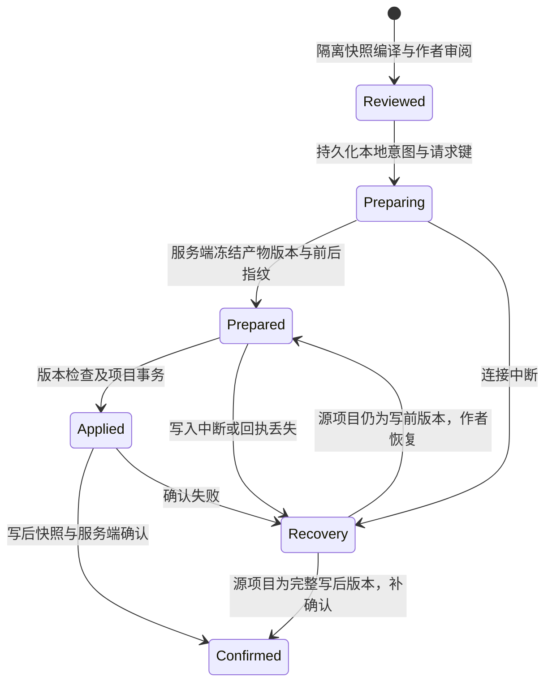

# Studio 制作组候选采用与恢复协议

- 日期：2026-10-27。
- 状态：部分实施；不可变候选修订、文字与作者宿主媒体里程碑的准备／事务写入／确认、Web 持久化恢复、条件撤销与独立作者收尾已接通本地替身联调。Studio 图片／配音导入口已连接服务端不可变登记，真实字节共用统一里程碑；同基线文字源文件合并已接通作者编辑、不可变回执和条件撤销；生产服务、Flow／媒体记录的直接合并、跨设备接续及原生 iOS 仍未验收。
- 范围：主计划 [T05／T09](../plans/2026-10-27-studio-creative-team) 的候选、正式项目写入与撤销。验收要求仍以主计划为准。

## 已实现的基础

人物和章节候选支持作者修订。每次修订创建新产物，保留 `editedFrom`、原产物、费用和决定原因；作者不能指定来源、文件路径、身份或媒体回执。修订不调用模型，不选定新候选，不修改正式项目。旧版本和相关下游变为过期，在途任务继续按实际回执结算。

Runtime 分别保存给模型的职责上下文和完整的冻结写入基线。返回产物的 `before` 来自派发时的基线，不能使用作者在生成期间刚更新的文件。源文件冲突和创建路径已被占用时，候选不得覆盖正式项目。人物叙事修订保留已有 frontmatter 中的媒体绑定与其他作者字段。

可用性声明中的 `authoring.candidateEdits` 明确表示支持修订；旧服务缺少声明时不开放按钮。新增服务的 `authoring.milestoneAdoption` 为 `true`，表示支持文字里程碑协议；未升级的服务保持关闭。查询能力、历史和已有候选不激活账户额度；新模型任务仍按既有 entitlement、预算和计费路径授权。

`authoring.voiceDirectionEdits` 另外声明配音方案的结构化修订。`voice-settings` 仅允许供应商无关的声音意图和字面词典变换；服务端从方案与写前快照重算完整变换，拒绝与声明不符的文件内容。源工作区编译这些修改后使用同一里程碑写入，不因此取得 Catalog／VoiceTake 或真实媒体核验权限。具体字段及保留边界见[配音规格](./2026-10-27-studio-creative-voice-import)。

## 采用边界

客户端已有 `CreativeMilestoneReviewService` 和 Studio 项目事务，但不能仅以本地 `apply()` 返回成功就把服务端任务标为完成。项目文件和服务端执行记录属于两个存储域，没有分布式事务。

采用分为准备、本地写入、确认三个阶段。服务端准备一个不会调用模型的采用意图；本地在写入前保存恢复日志，再以确切版本执行编译和原子项目事务；服务端核对写后快照后记录采用决定。任何中断都保留原候选和可核对的状态。

本机图片与配音共用[媒体中断恢复协议](./2026-10-27-studio-creative-media-recovery)。服务明确声明 `authoring.mediaCandidates` 后，两个导入口先登记不可变候选，再由统一里程碑审阅和写入。此路径使用独立的真实媒体工作区适配器；默认文字适配器仍不具有媒体权限。

该流程已接通文字与上述媒体候选；UI 的“选定”仅供后续伙伴参考，独立的“采用到项目”区域负责文件审阅和确认。配音未选登记与选用绑定分别创建产物，不能以一次导入隐式选用。

## 服务端意图与回执

准备请求包含运行 ID、幂等请求键、选定产物的 ID／指纹、当前已保存项目快照、审阅得到的候选版本、可选的作者合并结果和作者原因。服务端检查账号／项目、请求指纹、候选状态、来源和上游版本、允许的文件路径、逐文件 `before` 及合并冲突，从不可变产物及明确审阅的合并结果重新计算写入集合与写后指纹。

存在未结算子任务时，不开始首版正式采用；隔离预览仍可执行。准备后通过明确的待确认意图冻结后续派发和相冲突的事实更新。不会因超时自动恢复收费任务，也不能在本地写入结果不明时直接清掉意图。

如果被采用的候选依赖尚未采用的上游文件变更，必须把相应上游纳入里程碑，或先完成上游采用。同一文件的多个修改须进入明确的合并审阅；禁止后一个产物静默取代前一个。

确认请求包含意图 ID 和从项目重新读取的写后快照。服务端核对快照指纹、派生的完整文件转换和意图状态后，才更新共享事实、产物采用状态及决定记录。确认重放返回原结果；同一请求键的不同内容报冲突。回执引用不可变产物与版本。作者合并稿是新的决定内容，按冲突路径在意图中保留一份，以便重开、核对和撤销；原候选的完整内容不因此复制或改写。

首个接通的采用适配器只声明其真实支持的宿主能力。Catalog／VoiceTake 需要可信宿主核验真实媒体；不能因文本文件里出现 URL、assetId 或“成功”消息就标为媒体已采用。媒体核验未连接时保持拒绝。

## 同基线文字源文件合并

服务通过 `authoring.milestoneMerges` 声明支持；旧服务缺少声明时，不开放冲突合并。该免费作者操作与模型执行开关独立，不派发任务或新增费用。

Studio 在采用区按所选产物收集相同文件的贡献。写前和写后均逐字节相同的转换去重；其余同文件修改必须逐项审阅，不能依次覆盖。作者可展开基线与各候选，以某份候选起稿，再编辑完整结果或明确删除。每个结果都有单独确认；后续改字会清除确认和编译审阅，改变候选 ID／指纹也会清除其本地合并草稿。

准备请求的 `merges: [{ path, after }]` 只接受本次选定产物实际冲突的路径，不能添加其他文件或自定 `before`／来源／身份。每份贡献必须来自相同的 `before`，且当前源文件仍须精确匹配它。合并不自动接受作者在其他入口刚保存的新版本；旧审阅的确认会在发送准备请求前被实际项目版本检查阻止，不覆盖新稿。

首个编辑器支持 `adv/world.md`、`adv/outline.md`、规范人物文件、AdvScript 章节和 `adv/settings/game.json`。人物正文、名称和关系可编辑，但稳定 ID、媒体绑定、音色 Profile、授权及其他未知 frontmatter 值必须与基线一致；新人物以已审阅候选的稳定元数据为基线。Catalog、VoiceTake、配音设置及 Flow JSON 不接受此自由文本入口；不同基线或这些专用记录的冲突仍须拆分采用、重新生成或经各自专用流程处理。

每次最多 100 个合并路径，所有结果合计不超过 48 KiB UTF-8；原有写前／写后快照、最多 100 项文件变化与存储容量检查继续生效。里程碑 HTTP 路由与媒体登记一样最多 192 KiB，以容纳转义后的源快照和合并稿；其他普通任务请求仍为 64 KiB，显式全局限制优先。完整快照必须先编译，再单独确认写入。

服务将合并稿与确切候选引用、作者原因和请求指纹一起冻结。同键不同合并文本报冲突；确认和撤销重新构造这份结果，不能从当前候选猜测。采用后的只读回执明确展示实际合并稿，原候选保留为输入贡献，不伪称其原始内容逐字采用。

合并改变某份输入时，依赖该版本的下游即使没有复制源文件也会过期；直接读取改变文件的候选同样受影响。沿用未改变的选中版本的后代可保留锚点，不涉及改变读取的独立成果保留。受影响下游不能顺便纳入同次采用，须先移除，再为新源版本重做或审阅。合并输入可作为作者明确审阅的贡献记录采用。此处不把过期自动还原成已验证，也不将运行标记完成。

合并稿复用既有私有日志、事务和条件撤销。回执响应丢失时，重开只读实际文件与记录；补回执不会再次写文件。条件撤销恢复精确写前版本，保留候选历史；已被作者改过的项目仍禁止覆盖。

## 作者宿主媒体登记与服务端锚点

新增 `authoring.mediaCandidates` 声明和免费 `POST /runs/:runId/media-candidates`。它接收选定美术／配音方案的 ID 与指纹、当前已保存源快照、有限 Catalog／绑定变换、稳定目标 ID 和作者原因。服务端生成不可变的 `media-adoption` 产物及 `register-media` 决定；相同请求键与相同内容返回已有记录，复用键提交不同内容报冲突。登记不写正式项目，不发模型任务或新增费用，不将方案或运行改为完成。

记录的 `verification: author-host` 表示由作者宿主检查原文件。服务端没有上传、解码或读取媒体二进制，不能把作者提交的 SHA-256 声明当成供应商或服务器认证。模型输出解析器仍拒绝 `media-adoption`；公开请求也不能自定该来源标记、产物身份或收费回执。原始文件需由宿主核对真实字节、解码及绑定。

服务端另外验证有限数据变换：

- 图片只修改目标资源及其必要的场景绑定；保留既有 Profile、其他资源、未知场景 frontmatter 字段和精确正文。拒绝重复人物表情绑定、路径逃逸和源台词写入。画像、表情、背景共用相同协议；目前背景／表情仅有协议回归。
- 配音登记必须新增未选 take，保留其他行、语言、take 和原有选择。它核对已存在的音色 Profile 指纹、provider／voice／model／source／rights、输入指纹及授权文件存在性；不会创建自称供应商返回的新身份。输入指纹包括声明的发音版本，但本服务尚未重新计算词典应用或编译后的稳定台词对应关系；这些继续由实际作者宿主检查。
- `registered` 与 `selected` 是不同目标阶段。选用须引用同一方案下已确认登记的不可变媒体产物，只改变该语言的 `selectedTake`，不能重写候选或其他绑定。

登记请求最多 4 个文本文件；每个文本不超过 49,152 字符，写前／写后完整源快照仍须满足 48 KiB／256 文件限制。仅该 HTTP 路由放宽至 192 KiB；其他普通任务路由保持 64 KiB，试玩报告沿用 640 KiB，显式全局请求限制继续优先。

登记产物复用既有里程碑准备／确认／条件撤销。确认后更新原方案的采用锚点，避免本次媒体写入使自身方案过期；另一个已采用媒体只有在语义输入、哈希、大小、MIME、项目路径和目标绑定仍存续时才保留锚点。语义输入包含对应人物／场景，以及配音的源台词、人物音色、旁白 Profile、词典和游戏设置。来源核对也记录这些文件的缺失状态；之后新增词典不能复用冻结在“无词典”版本的配音。未选登记在后续选用时继续可复用；替换实际选中的 take 不会把旧选择当成现行绑定。独立图片不会因新增配音词典而被删除或错误续签配音锚点。

客户端协调器要求明确的 Catalog／VoiceTake 权限和 `workspace.verifyMedia`。写后确认、从完整写后版本恢复以及确认记录的本机对账都会调用核验器；缺少或损坏本次采用的媒体时保留待处理意图，不能仅凭文本版本相等补回执。核验器从实际文件解码图片／WAV，核对完整绑定，并从写后编译项目重新核对稳定台词、音色、词典应用及输入指纹。未接通核验器的 Studio 默认工作区继续拒绝这些媒体产物。撤销按既有精确版本约束恢复源文件并保留二进制，不为历史媒体新增认证，也不因无关旧素材缺失而阻止独立操作。

**当前接线范围**：共享契约、Managed 客户端和受鉴权 Runtime 路由已实现。Studio 新服务路径先持久化登记请求及幂等键，未知响应用原请求重试，不写项目；媒体候选在原私有表暂存真实字节。统一审阅可将不同文件的图片与未选配音一起采用，使用既有项目事务批量提交，服务确认后才清除私有冗余字节。兼容旧服务／旧记录的本机流程仍保留。浏览器通过真实 HTTP 的确定性本地协议服务联调，不伪造媒体解码或文件写入；身份、方案和服务存储仍为替身，生产与六角色质量验收仍未完成。

## 本地恢复日志

日志属于私有执行记录，按账号和项目隔离，不能写入或导出为游戏源文件。Web 使用按账号／项目／运行隔离的独立 Dexie 数据库 `advjs-studio-creative-adoptions`；原生客户端需要用同等的本地事务存储实现，不依赖浏览器对象；该适配器尚未实现。

写入前保存：运行和意图请求键、产物 ID／指纹、写前／写后指纹、审阅的文件转换与条件撤销数据。准备和写入返回后分别补记状态；在发送确认前持久化本地已写入状态。

重开或重连时先读取实际项目，不自动重写文件：

| 项目状态 | 恢复行为 |
| --- | --- |
| 完全匹配写前版本 | 提供恢复原采用或放弃意图；恢复前重新核对服务端和编译结果。 |
| 完全匹配写后版本 | 明确显示“已写入，回执待同步”，可幂等补确认。 |
| 审阅过的有限部分版本 | 所有目标逐字节等于写前或写后，其他源未变时，作者可明确继续或还原。缺少本次原始媒体时，继续需要私有候选保留的真实字节。 |
| 第三种内容或未知媒体 | 阻止覆盖和自动撤销，保留日志和候选；任意冲突合并仍待补齐。源完整匹配写前时可只放弃意图，不修改未知媒体。 |

后端落字节后报错不能直接表示项目没有变化。原生事务尽力回滚，随后仍以实际快照判断结果。切项目或账号后不得继续使用旧句柄写入，也不得把旧日志和异步结果展示给新作用域。

## 过期、撤销与运行完成

采用后的来源核对必须使用已确认写后锚点，并叠加本次采用的上游内容，不能把本次写入本身当作外部修改。之后作者修改相关人物、台词或资源时，仍需沿版本依赖传播过期；无关资源不受影响。

已知的隐式读取也属于来源依赖。Runtime 从派发时保存的完整基线补齐实际存在的设置／目录文件，未存在的仍按缺失核对；不能把角色上下文中未发送的文件误判为不存在，也不能从生成期间更新的事实反推原基线。美术／配音另外依赖可移植项目配置，配音的初始上下文包含游戏语言设置。

撤销同样使用准备／本地事务／确认流程，首版只支持确切匹配最近写后版本的条件撤销。撤销不退还模型费用，不删除产物历史；恢复创建、修改与删除的全部文件。版本已变更时进入冲突审阅。

文字采用会记录 `adopt`／`undo` 决定和不可变产物引用，不会把运行标为完成。已确认的写入通过采用锚点调整相关产物的来源核对；未依赖这些版本的其他候选仍会过期。

作者收尾是独立决定：最后一个子任务结算、全部方案选定或本地文件写入都不自动完成制作组。`authoring.delivery` 明确声明可用性；缺少声明的旧服务不显示操作。作者逐项说明当前选定／已采用成果的去向，先审阅完整记录，再明确确认结束。含文件修改的选定成果必须采用或明确排除，不能冒充参考建议；已采用成果必须有未被撤销的确认回执。纯建议可以保留作参考，但不等于建议所描述的素材或作品已经完成。

独立的 `POST /runs/:id/delivery` 只接受项目快照、运行版本、成果指纹、去向及理由、交付说明和未验证项确认。它复用现有鉴权与账号／项目边界，不激活额度、不调用模型、不写游戏文件；生成关闭时仍可用。服务端在同一运行事务中核对精确版本、全部任务已选定、零预留费用和无待确认里程碑，再从持久记录生成 `delivery` 回执与 `finish` 决定。客户端不能提交结算金额、伪造报告引用或指定任务成功。当前保存项目的实际试玩摘要才进入交付记录；保留试玩计划必须有同版本保存项目报告，成功执行计划中每个场景的确切选择与预期结局，失败、阻塞或候选快照报告不能代替它，也可以说明理由排除该计划。

Web 宿主在项目写入锁中重新编译真实快照、核验已采用媒体的字节与绑定，并在读取前后检查私有日志。相同账号／项目的其他制作组仍有待恢复写入，或本次有尚未同步的实际试玩报告时，阻止收尾。审阅后再次确认须重读项目与媒体；账号／项目／运行或源版本变化都不能复用旧审阅。准备提交的原请求及幂等键先存入独立 IndexedDB；响应丢失后先读取服务结果，同键同请求可恢复，换内容复用同键被拒绝。此决定只有服务端记录，不引入新的项目双写事务。

回执冻结决定时的项目版本、每项去向与理由、已确认里程碑、同版本试玩摘要、实际结算及工具调用；未制作的美术请求、未选用的配音请求另行列出。收尾后本次制作组的修订、返工、媒体登记、采用／撤销、事实更新和新报告写入被拒绝，原有幂等回执及报告仍可读取；作者仍可继续编辑正式项目并创建新制作组。UI 称“作者已结束本次制作组”，不以终态证明创作质量或发布资格。

上述汇总由真实记录确定生成，不伪装成导演模型的创作评价。双结局、画面与表演品质、真实音频播放、剧情一致性、未指定路径、六角色完整闭环及原生 iOS 仍按主计划独立验收。允许带明确排除项结束一次有限请求，不等于主计划 T03–T10 或整部作品验收完成。

## 实施边界与验证

最初实现只允许文字源文件；当前服务端与 Studio 媒体工作区还允许上述明确标记的作者宿主媒体产物，默认文字适配器仍拒绝 Catalog／VoiceTake。最多一次改变 100 个文件，写前与写后快照都须符合现有 48 KiB／256 文件的请求上限，写前即检查确认容量。媒体批量事务另限 32 个文件／64 MiB，校验失败回滚本轮新增二进制并保留既有文件。作者审阅允许合法空 Catalog，以便首轮媒体采用与还原，其他编译错误仍阻止写入。同基线文字源文件已提供明确的合并编辑与不可变回执；不同基线、Flow JSON 与专用媒体／音色记录仍拒绝自由合并。首版仅撤销最近一次确认的采用，并要求项目精确匹配该写后版本；不自动重写、覆盖作者修改或退还模型费用。

Web 内存文件系统新增严格持久化屏障；项目事务等待 IndexedDB 提交并观察错误，回滚也等待持久化。普通非关键自动保存保留原行为。只有原设备有本地恢复日志时才提供继续写入，其他设备显示待处理意图；原生 iOS 日志和跨设备接续仍待实现。

本地验证覆盖：写前冲突、同文件合并／未确认拒绝、合并后的下游过期、原候选保留、创建后失败回滚、写后响应丢失、准备／确认重放、切项目与账号、重开恢复及条件撤销。必须从重新读取的文件和持久化记录判断结果；模型自述、静态截图和预写消息不作为成功证据。本地采用协议以重新读取的实际文件对账，不代表真实角色创作或实际试玩通过。

当前可执行证据：Agent 协调器单元测试、Runtime 受鉴权 HTTP 集成测试，以及 Playwright 中真实 Studio 项目事务和 IndexedDB 的采用 → 丢失确认响应 → 刷新只读恢复 → 同步回执 → 条件撤销。协议服务与创作内容在浏览器测试中使用醒目标注的确定性 fixture，模型与计费调用为 0；具体数量、截图和发布状态见[验收记录](../reports/2026-10-27-studio-creative-team-acceptance)。
