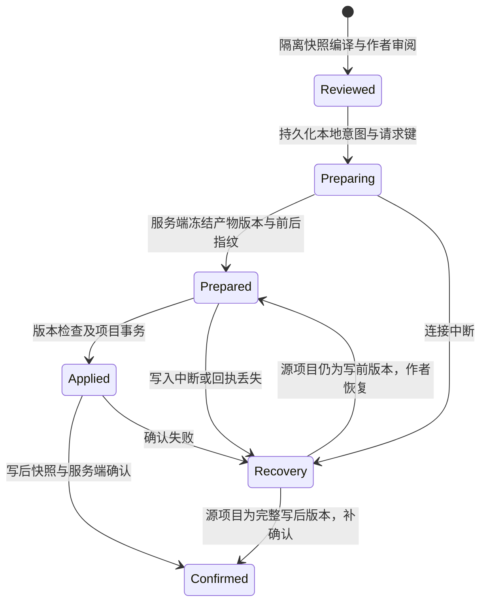

# Studio 制作组候选采用与恢复协议

- 日期：2026-10-27。
- 状态：部分实施；不可变候选修订、文字里程碑的准备／事务写入／确认、Web 持久化恢复和条件撤销已通过本地替身联调。生产服务、媒体核验、同文件合并及原生 iOS 仍未验收。
- 范围：主计划 [T05／T09](../plans/2026-10-27-studio-creative-team) 的候选、正式项目写入与撤销。验收要求仍以主计划为准。

## 已实现的基础

人物和章节候选支持作者修订。每次修订创建新产物，保留 `editedFrom`、原产物、费用和决定原因；作者不能指定来源、文件路径、身份或媒体回执。修订不调用模型，不选定新候选，不修改正式项目。旧版本和相关下游变为过期，在途任务继续按实际回执结算。

Runtime 分别保存给模型的职责上下文和完整的冻结写入基线。返回产物的 `before` 来自派发时的基线，不能使用作者在生成期间刚更新的文件。源文件冲突和创建路径已被占用时，候选不得覆盖正式项目。人物叙事修订保留已有 frontmatter 中的媒体绑定与其他作者字段。

可用性声明中的 `authoring.candidateEdits` 明确表示支持修订；旧服务缺少声明时不开放按钮。新增服务的 `authoring.milestoneAdoption` 为 `true`，表示支持文字里程碑协议；未升级的服务保持关闭。查询能力、历史和已有候选不激活账户额度；新模型任务仍按既有 entitlement、预算和计费路径授权。

## 采用边界

客户端已有 `CreativeMilestoneReviewService` 和 Studio 项目事务，但不能仅以本地 `apply()` 返回成功就把服务端任务标为完成。项目文件和服务端执行记录属于两个存储域，没有分布式事务。

采用分为准备、本地写入、确认三个阶段。服务端准备一个不会调用模型的采用意图；本地在写入前保存恢复日志，再以确切版本执行编译和原子项目事务；服务端核对写后快照后记录采用决定。任何中断都保留原候选和可核对的状态。

该流程已接通文字候选；UI 的“选定”仅供后续伙伴参考，独立的“采用到项目”区域负责文件审阅和确认。

## 服务端意图与回执

准备请求包含运行 ID、幂等请求键、选定产物的 ID／指纹、当前已保存项目快照、审阅得到的候选版本和作者原因。服务端检查账号／项目、请求指纹、候选状态、来源和上游版本、允许的文件路径、逐文件 `before` 及合并冲突，从不可变产物重新计算写入集合与写后指纹。

存在未结算子任务时，不开始首版正式采用；隔离预览仍可执行。准备后通过明确的待确认意图冻结后续派发和相冲突的事实更新。不会因超时自动恢复收费任务，也不能在本地写入结果不明时直接清掉意图。

如果被采用的候选依赖尚未采用的上游文件变更，必须把相应上游纳入里程碑，或先完成上游采用。同一文件的多个修改须进入明确的合并审阅；禁止后一个产物静默取代前一个。

确认请求包含意图 ID 和从项目重新读取的写后快照。服务端核对快照指纹、派生的完整文件转换和意图状态后，才更新共享事实、产物采用状态及决定记录。确认重放返回原结果；同一请求键的不同内容报冲突。回执引用不可变产物与版本，不在每份元数据中重复保存大型文件内容。

首个接通的采用适配器只声明其真实支持的宿主能力。Catalog／VoiceTake 需要可信宿主核验真实媒体；不能因文本文件里出现 URL、assetId 或“成功”消息就标为媒体已采用。媒体核验未连接时保持拒绝。

## 本地恢复日志

日志属于私有执行记录，按账号和项目隔离，不能写入或导出为游戏源文件。Web 使用按账号／项目／运行隔离的独立 Dexie 数据库 `advjs-studio-creative-adoptions`；原生客户端需要用同等的本地事务存储实现，不依赖浏览器对象；该适配器尚未实现。

写入前保存：运行和意图请求键、产物 ID／指纹、写前／写后指纹、审阅的文件转换与条件撤销数据。准备和写入返回后分别补记状态；在发送确认前持久化本地已写入状态。

重开或重连时先读取实际项目，不自动重写文件：

| 项目状态 | 恢复行为 |
| --- | --- |
| 完全匹配写前版本 | 提供恢复原采用或放弃意图；恢复前重新核对服务端和编译结果。 |
| 完全匹配写后版本 | 明确显示“已写入，回执待同步”，可幂等补确认。 |
| 两者均不匹配 | 阻止覆盖和自动撤销，保留日志和候选；逐文件恢复审阅仍待补齐。 |

后端落字节后报错不能直接表示项目没有变化。原生事务尽力回滚，随后仍以实际快照判断结果。切项目或账号后不得继续使用旧句柄写入，也不得把旧日志和异步结果展示给新作用域。

## 过期、撤销与运行完成

采用后的来源核对必须使用已确认写后锚点，并叠加本次采用的上游内容，不能把本次写入本身当作外部修改。之后作者修改相关人物、台词或资源时，仍需沿版本依赖传播过期；无关资源不受影响。

撤销同样使用准备／本地事务／确认流程，首版只支持确切匹配最近写后版本的条件撤销。撤销不退还模型费用，不删除产物历史；恢复创建、修改与删除的全部文件。版本已变更时进入冲突审阅。

文字采用会记录 `adopt`／`undo` 决定和不可变产物引用，不会把运行标为完成。已确认的写入通过采用锚点调整相关产物的来源核对；未依赖这些版本的其他候选仍会过期。

完成制作组是独立决定（尚未实现）：不能以最后一个子任务结算、全部文字方案选定或本地文件写入代替。需要核对已安排任务、选定成果的采用／排除决定、待处理费用和真实的媒体／试玩记录；未完成项如实保留。双结局、媒体播放和六角色完整闭环仍按主计划单独验收，原生 iOS 也须独立留证。

## 实施边界与验证

首个实现只允许文字源文件，拒绝 Catalog／VoiceTake；最多一次改变 100 个文件，写前与写后快照都须符合现有 48 KiB／256 文件的请求上限，写前即检查确认容量。同文件多项修改仍要求明确合并，目前提供冲突拒绝，合并编辑器未实现。首版仅撤销最近一次确认的采用，并要求项目精确匹配该写后版本；不自动重写、覆盖作者修改或退还模型费用。

Web 内存文件系统新增严格持久化屏障；项目事务等待 IndexedDB 提交并观察错误，回滚也等待持久化。普通非关键自动保存保留原行为。只有原设备有本地恢复日志时才提供继续写入，其他设备显示待处理意图；原生 iOS 日志和跨设备接续仍待实现。

本地验证覆盖：写前冲突、同文件冲突拒绝、创建后失败回滚、写后响应丢失、准备／确认重放、切项目与账号、重开恢复及条件撤销。必须从重新读取的文件和持久化记录判断结果；模型自述、静态截图和预写消息不作为成功证据。本地采用协议以重新读取的实际文件对账，不代表真实角色创作或实际试玩通过。

当前可执行证据：Agent 协调器单元测试、Runtime 受鉴权 HTTP 集成测试，以及 Playwright 中真实 Studio 项目事务和 IndexedDB 的采用 → 丢失确认响应 → 刷新只读恢复 → 同步回执 → 条件撤销。协议服务与创作内容在浏览器测试中使用醒目标注的确定性 fixture，模型与计费调用为 0；具体数量、截图和发布状态见[验收记录](../reports/2026-10-27-studio-creative-team-acceptance)。
